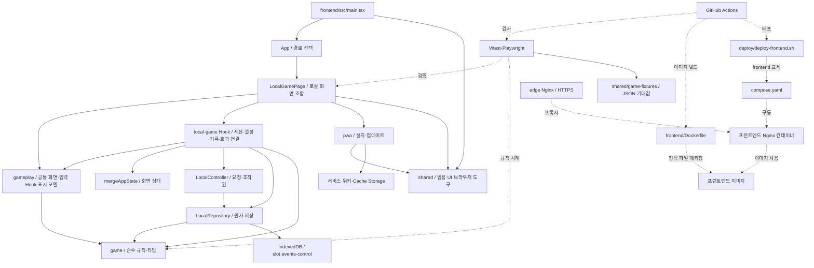

# ARCHITECTURE

## 개요

실물 카드 게임의 칩·베팅 순서·팟·수동 정산을 관리하는 React/TypeScript 앱이다.
현재 단일 기기 모드는 브라우저 IndexedDB에 게임과 기록을 보관하며 오프라인 PWA로 실행된다.
온라인 경로는 준비 중 안내만 제공하고, 공통 게임 UI와 로컬 운영 코드는 분리되어 있다.
이 문서는 현재 코드의 지도이며, 제품 요구와 규칙 상세는 [SPEC_INDEX.md](SPEC_INDEX.md)에서 찾는다.

## 전체 구조도

실선은 소스의 의존·호출 방향, 점선은 검사·빌드·배포의 연결이다.
브라우저 저장소와 서비스 워커는 실행 환경이며 애플리케이션 소스 폴더가 아니다.



화면에서 사용하는 규칙 계산과 저장소에서 수행하는 최종 규칙 검증은 목적이 다르다.
입력 가능 여부·미리보기는 화면을 돕고, 확정 상태 변경은 저장소의 명령 처리에서 수행한다.

## 디렉터리 지도

버전 관리되는 주요 디렉터리와 변경의 출발점만 정리한다.
파일 목록 전체나 제품 기획의 목차를 대신하지 않는다.

### 저장소 최상위

| 위치        | 역할 한 줄                              | 핵심 파일·심볼                                                                                                      |
| ----------- | --------------------------------------- | ------------------------------------------------------------------------------------------------------------------- |
| `frontend/` | 브라우저 앱·테스트·정적 이미지 빌드     | [package.json](frontend/package.json), [vite.config.ts](frontend/vite.config.ts), [Dockerfile](frontend/Dockerfile) |
| `shared/`   | 언어에 독립적인 규칙 테스트 입력·기대값 | `shared/game-fixtures/`, [schema.json](shared/game-fixtures/schema.json)                                            |
| `deploy/`   | 프런트엔드 교체·복구와 edge 구성        | [deploy-frontend.sh](deploy/deploy-frontend.sh), [README.md](deploy/README.md)                                      |
| `.github/`  | 검사·이미지 발행·배포·연결 확인 자동화  | [ci-images.yml](.github/workflows/ci-images.yml), [check-server.yml](.github/workflows/check-server.yml)            |
| `docs/`     | 책임별 리팩터링 계획과 검증 기록        | `docs/superpowers/plans/`                                                                                           |

루트의 [compose.yaml](compose.yaml)은 프런트엔드 컨테이너와 외부 네트워크·자산 볼륨을 연결한다.
edge 구성은 [deploy/edge/compose.yaml](deploy/edge/compose.yaml)로 별도 관리한다.
애플리케이션 명세의 입구는 [SPEC_INDEX.md](SPEC_INDEX.md), 작업 지침은 [AGENTS.md](AGENTS.md)다.
기술 선택의 이유는 [TECH_DECISIONS.md](TECH_DECISIONS.md), 실제 작업 이력은 [IMPLEMENTATION_PROGRESS.md](IMPLEMENTATION_PROGRESS.md)에 있다.

### 프런트엔드 진입과 규칙

| 위치                     | 역할 한 줄                            | 핵심 파일·심볼                                                                                                                     |
| ------------------------ | ------------------------------------- | ---------------------------------------------------------------------------------------------------------------------------------- |
| `frontend/src/`          | React 시작과 기능 모듈의 루트         | [main.tsx](frontend/src/main.tsx), [README.md](frontend/src/README.md)                                                             |
| `frontend/src/app/`      | URL에 따른 화면 선택과 기본 경로 이동 | [App.tsx](frontend/src/app/App.tsx): `App`, `AppRedirect`                                                                          |
| `frontend/src/game/`     | UI·저장소와 독립적인 게임 상태·규칙   | [types.ts](frontend/src/game/types.ts): `GameState`, `GameCommand`; [transition.ts](frontend/src/game/transition.ts): `transition` |
| `frontend/src/features/` | 공통 게임 기능과 모드별 운영의 경계   | `frontend/src/features/gameplay/`, `frontend/src/features/local-game/`, `frontend/src/features/pwa/`                               |

[main.tsx](frontend/src/main.tsx)는 `installZoomPolicy`를 설치하고 React 루트를 만든다.
[App.tsx](frontend/src/app/App.tsx)는 URL `/local/`에서 `LocalGamePage`를 렌더링한다.
URL `/online/`에서는 준비 중 안내를 보여주며, 기본 URL `/`는 로컬 URL로 문서 이동한다.
이 분기에는 라우터 라이브러리나 서버 연결이 없다.

게임 설정은 [settings.ts](frontend/src/game/settings.ts)의 `GameSettings`와 `validateSettings`에서 시작한다.
턴과 딜러 위치는 [positions.ts](frontend/src/game/positions.ts)의 `nextSeat`, `nextPositions`가 계산한다.
첫 핸드의 SB·BB는 `initialBlindSeats`가 정하며 규칙과 준비 화면 표시가 같이 쓴다.
상태 전이는 `createTournament`, `getLegalActions`, `transition`에 모여 있다.
`transition`은 명령별 처리기를 고르는 입구다. 처리기는 `commands/`의 [setup.ts](frontend/src/game/commands/setup.ts)·[betting.ts](frontend/src/game/commands/betting.ts)·[flow.ts](frontend/src/game/commands/flow.ts)에 있다.
핸드 진행 보조(납부·라운드·스트리트·지급)는 [round.ts](frontend/src/game/round.ts), 거절 처리는 [rule.ts](frontend/src/game/rule.ts)의 `requireRule`이다.
`GameCommand`는 명령마다 필드가 정해진 판별 유니온이며, 처리기 목록은 모든 명령을 갖도록 타입으로 강제된다.
베팅 초안 금액을 명령으로 바꾸는 분류는 [draft.ts](frontend/src/game/draft.ts)의 `classifyDraft`가 맡는다.
팟·지급은 [settlement.ts](frontend/src/game/settlement.ts), 무결성 검사는 [invariants.ts](frontend/src/game/invariants.ts)가 담당한다.
규칙은 문장 대신 [errors.ts](frontend/src/game/errors.ts)의 거절 코드를 반환한다.
화면 문구는 [errorMessages.ts](frontend/src/features/gameplay/model/errorMessages.ts)의 `messageFor`가 만든다.

### 모드 공통 게임 기능

| 위치                                         | 역할 한 줄                                   | 핵심 파일·심볼                                                                                                                                                                                                           |
| -------------------------------------------- | -------------------------------------------- | ------------------------------------------------------------------------------------------------------------------------------------------------------------------------------------------------------------------------ |
| `frontend/src/features/gameplay/`            | 모드가 제공한 값과 콜백으로 게임 UI 구성     | [GameScreen.tsx](frontend/src/features/gameplay/GameScreen.tsx): `GameScreen`; [session.ts](frontend/src/features/gameplay/session.ts): `GameSession`                                                                    |
| `frontend/src/features/gameplay/components/` | 테이블·입력·기록·정산 표현                   | [Table.tsx](frontend/src/features/gameplay/components/Table.tsx), [PlayerSeat.tsx](frontend/src/features/gameplay/components/PlayerSeat.tsx), [BoardCards.tsx](frontend/src/features/gameplay/components/BoardCards.tsx) |
| `frontend/src/features/gameplay/hooks/`      | 입력 초안·준비 편집·승자 선택·드래그·칩 효과 | [useBettingDraft.ts](frontend/src/features/gameplay/hooks/useBettingDraft.ts), [useSettlementSelection.ts](frontend/src/features/gameplay/hooks/useSettlementSelection.ts), `useSeatDrag`, `useChipMotion`               |
| `frontend/src/features/gameplay/model/`      | 화면용 데이터·배치·기록 변환                 | [tableView.ts](frontend/src/features/gameplay/model/tableView.ts): `buildTableView`; [history.ts](frontend/src/features/gameplay/model/history.ts): `historyRows`                                                        |
| `frontend/src/features/gameplay/styles/`     | 게임 화면과 컨트롤 스타일                    | [table.css](frontend/src/features/gameplay/styles/table.css), [controls.css](frontend/src/features/gameplay/styles/controls.css)                                                                                         |

`GameScreen`은 헤더·`Table`·하단 독의 상태별 분기·게임 대화상자와 UNDO 처리를 조립한다.
모드는 `GameSession`(상태·잠금 여부·권한·허용 행동·화면 기준 좌석·조작 scope·`run`·`dispatch`·`notify`·`loadEvents`)과 준비 편집 콜백, 관리 메뉴 슬롯을 넘긴다.
화면 기준 좌석 `viewSeat`은 게임 상태가 아니라 화면 값이다. 로컬은 고른 회전을, 온라인은 보는 사람의 자기 좌석을 넘긴다.
권한은 [capabilities.ts](frontend/src/features/gameplay/model/capabilities.ts)의 `GameCapabilities`이며 로컬은 `fullCapabilities`를 넘긴다.
`Table`은 좌석 배치·중앙 조작·팟 탐색을 담당하고, 카드 글자 맞춤은 범용 `useFitText`를 쓴다.
준비 편집 조작은 `Table`의 `setup` prop 하나로 받으며, 이 값이 있을 때만 편집 화면이 된다.
`PlayerSeat`는 카드 표현과 이름 편집 연결을, `BoardCards`는 보드 표시와 등장 애니메이션을 담당한다.
[InlineName.tsx](frontend/src/features/gameplay/components/InlineName.tsx)는 이름 문자열·IME·저장 완료 순서를 다룬다.
[BlindSettings.tsx](frontend/src/features/gameplay/components/BlindSettings.tsx)는 초기 SB·BB와 저장 콜백만 받는다.
표시용 좌석 좌표는 [seatLayout.ts](frontend/src/features/gameplay/model/seatLayout.ts)의 `seatCoordinates`를 함께 사용한다.

### 로컬 운영과 저장

| 위치                                           | 역할 한 줄                           | 핵심 파일·심볼                                                                                                                                                                                         |
| ---------------------------------------------- | ------------------------------------ | ------------------------------------------------------------------------------------------------------------------------------------------------------------------------------------------------------ |
| `frontend/src/features/local-game/`            | 로컬 화면과 복구 수명 조합           | [LocalGamePage.tsx](frontend/src/features/local-game/LocalGamePage.tsx): `LocalGamePage`, `LocalGame`                                                                                                  |
| `frontend/src/features/local-game/components/` | 로컬 홈·관리 메뉴                    | [LocalHome.tsx](frontend/src/features/local-game/components/LocalHome.tsx), [ManagerMenu.tsx](frontend/src/features/local-game/components/ManagerMenu.tsx)                                             |
| `frontend/src/features/local-game/hooks/`      | 로컬 세션·인원·회전·효과 연결        | [useLocalSession.ts](frontend/src/features/local-game/hooks/useLocalSession.ts), `useLocalSetupExtras`, `useLocalChipMotion`                                                                           |
| `frontend/src/features/local-game/model/`      | 로컬 화면 상태와 명령 기반 효과 계산 | [appState.ts](frontend/src/features/local-game/model/appState.ts): `AppState`, `mergeAppState`; [localChipTransfers.ts](frontend/src/features/local-game/model/localChipTransfers.ts): `chipTransfers` |
| `frontend/src/features/local-game/storage/`    | 조작권·요청·검증·IndexedDB 원자 저장 | [controller.ts](frontend/src/features/local-game/storage/controller.ts): `LocalController`; [repository.ts](frontend/src/features/local-game/storage/repository.ts): `LocalRepository`                 |

`LocalGamePage`는 복구를 위해 자식 로컬 게임을 다시 만들 때도 유지할 상태를 가진다.
내부 `LocalGame`은 세션·준비 편집·PWA·알림을 `GameSession`으로 묶어 `GameScreen`에 넘긴다.
로딩·복원 오류 화면, 로컬 오류 배너, 홈, 업데이트 대화상자와 토스트 표시는 이 페이지에 남는다.
`useLocalSession`은 세션 실행 중 저장소·컨트롤러와 실행 잠금을 관리한다.
탭 사이 알림은 `useCrossTabOwnership`, 페이지 복귀 감지는 `usePageResume`이 맡는다.
실행 잠금은 [commandRunner.ts](frontend/src/shared/async/commandRunner.ts)의 `createCommandRunner`이며, 삭제 확인 창은 페이지가 `ask` 콜백으로 넘긴다.
저장소의 요청·결과·조작권 타입은 [types.ts](frontend/src/features/local-game/storage/types.ts)에 있다.
`LocalController`는 현재 상태·조작권·미확정 요청·요청 순번을 보관한다.
`LocalRepository`는 규칙 실행과 상태·이벤트·조작권 기록의 커밋 경계다.

[database.ts](frontend/src/features/local-game/storage/database.ts)의 `openDatabase`가 저장소를 연다.
[restore.ts](frontend/src/features/local-game/storage/restore.ts)의 `validateStored`가 저장 형식과 게임 무결성을 검사한다.
[storageDeadline.ts](frontend/src/features/local-game/storage/storageDeadline.ts)의 `storageDeadline`은 무응답 작업의 대기를 제한한다.
화면 복원은 최신 상태를 읽으며, 기록 전체를 재생해 게임을 재구축하지 않는다.

### PWA와 범용 코드

| 위치                           | 역할 한 줄                                | 핵심 파일·심볼                                                                                                                                                                      |
| ------------------------------ | ----------------------------------------- | ----------------------------------------------------------------------------------------------------------------------------------------------------------------------------------- |
| `frontend/src/features/pwa/`   | 설치·업데이트의 브라우저 처리와 안내 정책 | [register.ts](frontend/src/features/pwa/register.ts): `useLocalPWA`; [usePwaPresentation.ts](frontend/src/features/pwa/usePwaPresentation.ts), `useInstallPrompt`, `checkForUpdate` |
| `frontend/src/shared/`         | 게임·모드와 독립적인 UI·브라우저 도구     | `Dialog`, `useScreenFit`, `useFitText`, `installZoomPolicy`                                                                                                                         |
| `frontend/src/shared/ui/`      | 공통 대화상자와 닫기 동작                 | [Dialog.tsx](frontend/src/shared/ui/Dialog.tsx): `Dialog`                                                                                                                           |
| `frontend/src/shared/hooks/`   | 화면·대화상자의 크기 맞춤, 토스트 타이머  | [useScreenFit.ts](frontend/src/shared/hooks/useScreenFit.ts): `useScreenFit`; [useToast.ts](frontend/src/shared/hooks/useToast.ts): `useToast`                                      |
| `frontend/src/shared/browser/` | 브라우저 확대 입력 정책                   | [zoomPolicy.ts](frontend/src/shared/browser/zoomPolicy.ts): `installZoomPolicy`                                                                                                     |
| `frontend/src/shared/styles/`  | 전역 토큰과 기본 스타일                   | [tokens.css](frontend/src/shared/styles/tokens.css)                                                                                                                                 |

[vite.config.ts](frontend/vite.config.ts)가 서비스 워커 생성과 HTML 빌드 진입점을 정한다.
로컬 manifest는 [manifest.webmanifest](frontend/public/local/manifest.webmanifest)에 있다.
PWA 등록은 로컬 게임에서 호출하는 `useLocalPWA`가 담당한다.
업데이트·설치 안내를 언제 보여줄지는 `usePwaPresentation`이 결정한다.

## 기능 → 코드 위치 표

| 기능                               | 주요 파일                                                                                                                                                                                                                                                                                            | 핵심 함수·컴포넌트                                                        | 관련 명세                                                                |
| ---------------------------------- | ---------------------------------------------------------------------------------------------------------------------------------------------------------------------------------------------------------------------------------------------------------------------------------------------------- | ------------------------------------------------------------------------- | ------------------------------------------------------------------------ |
| 게임 준비·이름·딜러·좌석 편집      | [useSetupEditing.ts](frontend/src/features/gameplay/hooks/useSetupEditing.ts), [SetupPanel.tsx](frontend/src/features/gameplay/components/SetupPanel.tsx), [settings.ts](frontend/src/game/settings.ts)                                                                                              | `useSetupEditing`, `SetupPanel`, `validateSettings`                       | [UX_SPEC.md](UX_SPEC.md), [GAME_SPEC.md](GAME_SPEC.md)                   |
| 베팅 입력·콜·레이즈 가능 여부      | [useBettingDraft.ts](frontend/src/features/gameplay/hooks/useBettingDraft.ts), [BetControls.tsx](frontend/src/features/gameplay/components/BetControls.tsx), [transition.ts](frontend/src/game/transition.ts)                                                                                        | `useBettingDraft`, `BetControls`, `getLegalActions`                       | [GAME_SPEC.md](GAME_SPEC.md), [UX_SPEC.md](UX_SPEC.md)                   |
| 메인·사이드 팟과 미콜 반환         | [settlement.ts](frontend/src/game/settlement.ts), [round.ts](frontend/src/game/round.ts), [tableView.ts](frontend/src/features/gameplay/model/tableView.ts)                                                                                                                                          | `buildPots`, `returnUncalled`, `buildTableView`                           | [GAME_SPEC.md](GAME_SPEC.md)                                             |
| 승자 선택·동률·지급 미리보기·정산  | [useSettlementSelection.ts](frontend/src/features/gameplay/hooks/useSettlementSelection.ts), [PayoutPreview.tsx](frontend/src/features/gameplay/components/PayoutPreview.tsx), [settlement.ts](frontend/src/game/settlement.ts)                                                                      | `useSettlementSelection`, `previewSettlement`, `PayoutPreview`            | [GAME_SPEC.md](GAME_SPEC.md), [UX_SPEC.md](UX_SPEC.md)                   |
| 직전 행동 되돌리기                 | [transition.ts](frontend/src/game/transition.ts), [GameScreen.tsx](frontend/src/features/gameplay/GameScreen.tsx), [history.ts](frontend/src/features/gameplay/model/history.ts)                                                                                                                     | `transition`, `resetWinners`, `historyRows`                               | [GAME_SPEC.md](GAME_SPEC.md), [SYSTEM_SPEC.md](SYSTEM_SPEC.md)           |
| 다음 핸드 블라인드 예약            | [BlindSettings.tsx](frontend/src/features/gameplay/components/BlindSettings.tsx), [commands/flow.ts](frontend/src/game/commands/flow.ts)                                                                                                                                                             | `BlindSettings`, `transition`                                             | [GAME_SPEC.md](GAME_SPEC.md), [UX_SPEC.md](UX_SPEC.md)                   |
| 로컬 저장·이어하기·다른 탭 인수    | [useLocalSession.ts](frontend/src/features/local-game/hooks/useLocalSession.ts), [controller.ts](frontend/src/features/local-game/storage/controller.ts), [repository.ts](frontend/src/features/local-game/storage/repository.ts), [restore.ts](frontend/src/features/local-game/storage/restore.ts) | `useLocalSession`, `LocalController`, `LocalRepository`, `validateStored` | [SYSTEM_SPEC.md](SYSTEM_SPEC.md), [TECH_DECISIONS.md](TECH_DECISIONS.md) |
| 핸드 기록·역순·더 보기             | [useEventHistory.ts](frontend/src/features/gameplay/hooks/useEventHistory.ts), [eventPages.ts](frontend/src/features/gameplay/model/eventPages.ts), [history.ts](frontend/src/features/gameplay/model/history.ts), [HistoryPanel.tsx](frontend/src/features/gameplay/components/HistoryPanel.tsx)    | `useEventHistory`, `readAllEvents`, `historyRows`, `HistoryPanel`         | [UX_SPEC.md](UX_SPEC.md), [SYSTEM_SPEC.md](SYSTEM_SPEC.md)               |
| 보드·칩 이동 효과                  | [BoardCards.tsx](frontend/src/features/gameplay/components/BoardCards.tsx), [useLocalChipMotion.ts](frontend/src/features/local-game/hooks/useLocalChipMotion.ts), [useChipMotion.ts](frontend/src/features/gameplay/hooks/useChipMotion.ts)                                                         | `BoardCards`, `useLocalChipMotion`, `useChipMotion`                       | [UX_SPEC.md](UX_SPEC.md)                                                 |
| PWA 설치·오프라인·업데이트         | [register.ts](frontend/src/features/pwa/register.ts), [usePwaPresentation.ts](frontend/src/features/pwa/usePwaPresentation.ts), [vite.config.ts](frontend/vite.config.ts)                                                                                                                            | `useLocalPWA`, `usePwaPresentation`, `useInstallPrompt`                   | [TECH_DECISIONS.md](TECH_DECISIONS.md), [UX_SPEC.md](UX_SPEC.md)         |
| 화면 맞춤·입력 중 키보드·확대 정책 | [useScreenFit.ts](frontend/src/shared/hooks/useScreenFit.ts), [zoomPolicy.ts](frontend/src/shared/browser/zoomPolicy.ts)                                                                                                                                                                             | `useScreenFit`, `installZoomPolicy`                                       | [UX_SPEC.md](UX_SPEC.md)                                                 |
| 이미지 빌드·프런트엔드 배포·복구   | [ci-images.yml](.github/workflows/ci-images.yml), [Dockerfile](frontend/Dockerfile), [deploy-frontend.sh](deploy/deploy-frontend.sh)                                                                                                                                                                 | `checks`, `publish`, `deploy`, `healthy`, `activate`                      | [DEPLOYMENT_SPEC.md](DEPLOYMENT_SPEC.md), [배포 안내](deploy/README.md)  |

## 데이터·상태 흐름

### 상태의 소유자

| 상태                                    | 소유 위치                                                         | 저장 여부                 |
| --------------------------------------- | ----------------------------------------------------------------- | ------------------------- |
| 확정 게임·현재 핸드·되돌리기 스냅샷     | `GameState`; `LocalController`와 `useLocalSession`의 화면 반영 값 | IndexedDB                 |
| 조작 화면·세대·처리 순번·최근 요청 결과 | `LocalRepository`의 `ControlRecord`                               | IndexedDB                 |
| 저장 중·실패·조작권 상실·홈 여부        | `AppState`, `mergeAppState`                                       | React 메모리              |
| 베팅 금액·승자 선택·현재 팟             | `useBettingDraft`, `useSettlementSelection`                       | React 메모리              |
| 이름·숫자 문자열·IME 편집 상태          | `InlineName`, `SetupPanel`, `BlindSettings`                       | 컴포넌트 메모리           |
| 로컬 화면 기준 좌석(회전)               | `useLocalViewSeat`, `viewSeatStore`                               | localStorage (토너먼트별) |
| 복구 재생성 key·업데이트 안내 보류      | `LocalGamePage`                                                   | 부모 컴포넌트 메모리      |
| 열린 대화상자·토스트                    | `LocalGame`, `useToast`                                           | React 메모리              |

### 일반 명령 처리

1. 사용자가 `BetControls`, 준비 폼 또는 테이블 카드를 조작한다.
   공통 UI는 로컬 저장소를 호출하지 않고 전달받은 콜백을 실행한다.
2. `useBettingDraft`는 모드가 넘긴 허용 행동(`GameSession.legal`)으로 금액 초안을 관리한다.
   SUBMIT 금액은 `classifyDraft`가 `GameCommand` 또는 거절 코드로 바꾼다.
   준비 편집은 `useSetupEditing`, 승자 선택은 `useSettlementSelection`이 맡는다.
   인원 추가·삭제는 로컬 전용 `useLocalSetupExtras`에 있다.
   화면 회전은 명령·저장 없이 `useLocalViewSeat`이 localStorage에 기억한다. 예전 저장 데이터의 `settings.viewSeat`는 처음 한 번 초기값으로 이어받는다.
3. `GameScreen`이 `GameSession.guard`로 잠금을 확인하고 세션의 `run`, `dispatch`를 호출한다.
   로컬에서는 `useLocalSession`의 `run`, `dispatch`가 연결된다.
   이때 칩 이동용 좌표를 미리 준비하지만 확정 효과는 아직 재생하지 않는다.
4. `LocalController.dispatch`가 조작권·기대 버전·토너먼트·핸드·요청 순번을 묶어 `Request`를 만든다.
   처리 중인 요청이 있으면 새 요청을 시작하지 않는다.
5. `LocalRepository.dispatch`가 하나의 트랜잭션 안에서 조작권·중복·순번·기대 버전을 검사한다.
   일반 게임 명령은 `transition`을 호출하고, 새 토너먼트는 `createTournament`로 만든다.
6. 규칙 결과와 이벤트, 요청 처리 결과를 저장한 뒤 트랜잭션 완료를 기다린다.
   성공한 결과만 `APPLIED`로 반환하며 저장 결과를 확신할 수 없는 오류는 `UNKNOWN`으로 반환한다.
   `REJECTED`의 `reason`은 규칙·세션 거절 코드이며 화면은 `messageFor`로 안내한다.
7. `LocalController`가 확정 결과를 받아 상태와 미확정 요청을 갱신한다.
   `useLocalSession`이 `mergeAppState`를 통해 React 화면 상태에 반영한다.
8. `buildTableView`가 확정 상태와 현재 입력 초안을 화면 데이터로 변환한다.
   `Table`과 하위 카드가 다시 표시되고, 결과 버전이 맞는 경우 준비한 칩 효과를 재생한다.

### 실패·복원·기록

- `UNKNOWN`이면 기존 확정 상태를 유지하고 원래 `Request`를 보관한다.
  `retryStorage`는 `LocalController.retry`로 같은 요청을 재확인한다.
- 최근 결과가 보관된 동일 요청은 기존 결과를 반환한다.
  결과 보관에서 밀려난 과거 순번도 새 명령으로 재실행하지 않는다.
- 복원은 `LocalController.refresh` → `LocalRepository.load` → `validateStored`로 진행한다.
  최신 스냅샷과 조작권을 확인하며 저장 이벤트 전체를 재실행하지 않는다.
- 저장소 연결 변경·무응답은 `storageDeadline`과 복원 세대 검사로 다룬다.
  늦게 도착한 복원 결과는 현재 화면 상태를 덮어쓰지 않는다.
- 다른 탭의 변경 알림은 재조회 계기다.
  실제 쓰기 권한은 BroadcastChannel 메시지가 아니라 IndexedDB의 조작 세대로 검증한다.
- 기록 창이 열리면 `GameHistoryPanel`이 `useEventHistory`로 `GameSession.loadEvents`를 호출한다.
  `readAllEvents`가 시간순으로 100개씩 끝까지 모은 뒤 `historyRows`가 취소를 반영하고, `HistoryPanel`이 정렬·더 보기를 관리한다.
  로컬은 `LocalRepository.readEvents`를 넘기고, 온라인은 서버 조회를 넘긴다.

## 이걸 바꾸려면 여기를 본다

먼저 시작 파일을 읽고, 규칙 변경이면 공통 JSON 기대값과 관련 테스트까지 함께 확인한다.

| 수정 요청                               | 시작할 파일                                                                                                                                                                                                                                   | 함께 확인할 경계                                                                                   |
| --------------------------------------- | --------------------------------------------------------------------------------------------------------------------------------------------------------------------------------------------------------------------------------------------- | -------------------------------------------------------------------------------------------------- |
| 이름·시작 칩·참가자 수 검증 변경        | [settings.ts](frontend/src/game/settings.ts)                                                                                                                                                                                                  | `validateSettings`; 준비 UI와 복원 검증도 같은 규칙 사용                                           |
| 이름 편집·좌석 드래그·첫 딜러 조작 변경 | [useSetupEditing.ts](frontend/src/features/gameplay/hooks/useSetupEditing.ts), [InlineName.tsx](frontend/src/features/gameplay/components/InlineName.tsx)                                                                                     | IME, 저장 완료 순서, `useSeatDrag`                                                                 |
| 칩 버튼·BET 초안 동작 변경              | [useBettingDraft.ts](frontend/src/features/gameplay/hooks/useBettingDraft.ts), [BetControls.tsx](frontend/src/features/gameplay/components/BetControls.tsx)                                                                                   | `classifyDraft`와 최종 `transition` 검증의 일치 테스트를 함께 확인                                 |
| 콜·최소 레이즈·짧은 올인·턴 규칙 변경   | [commands/betting.ts](frontend/src/game/commands/betting.ts), [legal.ts](frontend/src/game/legal.ts), [round.ts](frontend/src/game/round.ts)                                                                                                  | `getLegalActions`, 공통 베팅 사례, 총량 불변 조건                                                  |
| 팟 분리·동률·나머지 칩 배분 변경        | [settlement.ts](frontend/src/game/settlement.ts)                                                                                                                                                                                              | `buildPots`, `previewSettlement`, 승자 선택 미리보기                                               |
| 무르기 범위나 취소 후 기록 변경         | [transition.ts](frontend/src/game/transition.ts) `undoable`, [commands/flow.ts](frontend/src/game/commands/flow.ts), [history.ts](frontend/src/features/gameplay/model/history.ts)                                                            | 스냅샷·이벤트 식별자와 `resetWinners`                                                              |
| 이어하기·조작권 인수·저장 재시도 변경   | [useLocalSession.ts](frontend/src/features/local-game/hooks/useLocalSession.ts), [repository.ts](frontend/src/features/local-game/storage/repository.ts)                                                                                      | `LocalController`, 동일 요청 보존, 트랜잭션 경계                                                   |
| 테이블·카드·보드 배치나 글자 크기 변경  | [Table.tsx](frontend/src/features/gameplay/components/Table.tsx), [table.css](frontend/src/features/gameplay/styles/table.css)                                                                                                                | `seatCoordinates`, `useScreenFit`, `useFitText`, DOM 선택자                                        |
| 칩 이동 금액 또는 효과 변경             | [eventTransfers.ts](frontend/src/features/gameplay/model/eventTransfers.ts), [localChipTransfers.ts](frontend/src/features/local-game/model/localChipTransfers.ts), [useChipMotion.ts](frontend/src/features/gameplay/hooks/useChipMotion.ts) | 계산과 재생을 구분하고 저장 성공·재시도·정리 확인                                                  |
| 설치 제안·업데이트 노출 시점 변경       | [usePwaPresentation.ts](frontend/src/features/pwa/usePwaPresentation.ts), [register.ts](frontend/src/features/pwa/register.ts)                                                                                                                | 홈 여부·저장 잠금·미확정 요청·업데이트 적용                                                        |
| 멀티플레이 연결 시작                    | [App.tsx](frontend/src/app/App.tsx), [session.ts](frontend/src/features/gameplay/session.ts)                                                                                                                                                  | `GameSession` 계약, 공통 UI의 props 경계와 [SYSTEM_SPEC.md](SYSTEM_SPEC.md); 현재 서버 구현은 없음 |
| CI·정적 자산 보존·배포 복구 변경        | [ci-images.yml](.github/workflows/ci-images.yml), [deploy-frontend.sh](deploy/deploy-frontend.sh)                                                                                                                                             | 이미지 digest·revision, 과거 자산 보존, 복구 마커                                                  |

## 불변 조건과 경계

### 의존 방향

아래 경계는 [eslint.config.js](frontend/eslint.config.js)의 `no-restricted-imports`로 lint에서 검사한다.
`features/online-game/`이 생기면 로컬과 서로 import하지 않는 규칙도 이미 적용된다.

- `frontend/src/game/`의 import는 같은 규칙 디렉터리 안의 모듈로 한정된다.
  React·IndexedDB·로컬 세션·게임 UI를 import하지 않는다.
- `frontend/src/shared/`는 React와 내부 범용 모듈을 사용한다.
  게임 규칙·기능 폴더·앱 진입점을 import하지 않는다.
- `frontend/src/features/gameplay/`는 React·내부 공통 게임 모듈·순수 게임 규칙을 사용한다.
  로컬 저장소·PWA·로컬 페이지를 import하지 않는다.
- `frontend/src/features/pwa/`는 내부 모듈·React·가상 PWA 등록 모듈과 범용 다이얼로그를 사용한다.
  로컬 세션·저장소를 import하지 않고 저장 읽기 등을 콜백으로 받는다.
- 로컬 페이지와 Hook이 이 모듈들을 조합한다.
  `mergeAppState`는 화면 상태를 병합할 뿐 저장 부작용을 수행하지 않는다.

### 규칙과 원자 저장

- `transition`은 입력 상태를 복제해 계산한다.
  ID·시각은 `TransitionContext`로 전달받으며 규칙 내부에서 브라우저 저장을 하지 않는다.
- `assertInvariants`는 정수·5 단위 칩, 잔액과 팟의 총량, 납부 원장과 차례의 일관성을 검사한다.
  규칙 변경 시 화면이 그럴듯한지만 확인하지 말고 이 검사와 JSON 사례를 함께 본다.
- `LocalRepository`는 상태·이벤트·조작권을 같은 트랜잭션에 묶는다.
  상태만 저장하고 기록은 나중에 쓰는 경로로 분리하지 않는다.
- `screenId`와 `generation` 검사, 기대 상태 버전 검사, 순번 중복 검사는 서로 다른 역할이다.
  화면에서 버튼을 막았다는 이유로 저장 단계의 검사를 생략하지 않는다.
- `highWatermark`는 최근 결과 보관과 별개로 남는다.
  최근 64개 결과가 정리되어도 이미 처리한 과거 순번을 신규 요청으로 실행하지 않는다.

### 확정 상태와 입력 수명

- 베팅 초안은 화면 표시 값이며 확정 잔액을 바꾸지 않는다.
  저장 성공 전에 낙관적으로 확정 상태를 대체하지 않는다.
- `useBettingDraft`는 호출자의 scope와 상태 버전이 맞는 초안만 표시한다.
  로컬 페이지는 토너먼트와 조작 세대를 scope로 조합한다.
- `useSettlementSelection`의 로컬 scope에는 토너먼트·핸드·조작 세대가 들어간다.
  상태 버전만 바뀌는 블라인드 예약에서는 승자 선택을 유지한다.
- 성공한 무르기와 무르기 재시도는 `resetWinners`로 이전 선택을 폐기한다.
  두 입력 Hook을 같은 버전 초기화 규칙으로 합치지 않는다.
- `GameCapabilities`는 버튼 노출과 화면 안의 명령 차단만 담당한다.
  로컬은 모든 권한을 갖고, 조작권 상실은 `busy`·`guard`와 저장소 검사가 계속 막는다.
- 입력 문자열·IME·blur 저장은 해당 폼과 이름 편집 컴포넌트의 책임이다.
  `BlindSettings`의 초기값 전달을 매 렌더 입력 덮어쓰기로 바꾸지 않는다.

### 표시·기록·애니메이션

- 기록은 시간순으로 100개씩 읽어 전체 취소 관계를 해석한 뒤 표시한다.
  조회 페이지 경계마다 취소를 독립 처리하지 않는다.
- 이벤트를 칩 이동으로 바꾸는 일은 공통 `eventsToTransfers`, 범용 재생은 `useChipMotion`이 맡는다.
  로컬 `chipTransfers`는 규칙을 미리 실행해 이벤트를 예측하는 부분만 가진다. 온라인은 서버가 확정한 이벤트를 바로 넘긴다.
  재생 Hook에는 게임 상태·저장 요청 타입·규칙 실행 의존성이 없다.
- 재생은 확정된 결과 버전과 동일 요청 재시도 확인에 연결된다.
  화면 크기·표시 문맥 변경 후에는 이전 좌표의 준비된 효과가 재생되지 않도록 epoch를 무효화한다.
- 카드 ID·편집 scope key·DOM 선택자는 편집 수명과 드래그·칩 효과의 연결 지점이다.
  카드에 래퍼를 추가하거나 클릭·포인터 핸들러 순서를 바꿀 때 관련 E2E를 확인한다.

### PWA·배포·후속 모드

- URL `/local/`만 manifest 연결과 서비스 워커 등록 대상이다.
  기본·로컬·온라인 HTML 진입점은 [vite.config.ts](frontend/vite.config.ts)에 각각 정의된다.
- 서비스 워커 scope와 캐시 목록은 별개다.
  청크·진입점 변경 시 로컬 오프라인 의존성과 온라인 전용 자산의 캐시 제외를 같이 확인한다.
- 설치·업데이트 UI는 로컬 화면이 제어하며 공통 게임 컴포넌트가 등록을 시작하지 않는다.
  업데이트 적용 전에는 저장 중·미확정 요청 여부와 저장 상태 읽기를 확인한다.
- 배포는 이미지 digest와 revision을 확인하고 새 자산을 기존 자산 볼륨에 덮어쓰지 않고 추가한다.
  열린 클라이언트의 이전 해시 URL을 유지하며 교체 실패 시 이전 이미지 복구를 시도한다.
- 실패한 복구의 마커는 다음 배포를 막는다.
  [배포 안내](deploy/README.md)를 확인하지 않고 마커를 지워 재시작하는 방식으로 우회하지 않는다.
- 온라인 경로는 현재 안내 화면이다.
  향후 온라인 결과 확정과 권한 검증을 로컬 저장 Hook 또는 클라이언트 예측으로 대신하지 않는다.

## 테스트·검증 위치

### 단위 테스트와 공통 사례

- `frontend/tests/game/`: 상태 전이·베팅·팟·정산·무르기·총량 검사.
  [fixtures.test.ts](frontend/tests/game/fixtures.test.ts)는 공통 JSON의 스키마와 사례를 확인한다.
- `shared/game-fixtures/`: 설정·위치·베팅·팟·정산·수명 사례의 입력과 기대값.
  [schema.json](shared/game-fixtures/schema.json)은 사례 형식을 정의한다.
- `frontend/tests/local/`: 저장 원자성·조작권·중복 요청·복원·무응답 저장 테스트.
  [repository.test.ts](frontend/tests/local/repository.test.ts), [recovery.test.ts](frontend/tests/local/recovery.test.ts)가 시작점이다.
- `frontend/tests/ui/`: 기록 변환·좌석 이동·테이블 표시 데이터·칩 이동 계산.
  소스는 기능 폴더로 옮겨졌지만 이 테스트 디렉터리 이름은 유지한다.
- `frontend/tests/pwa/`: 업데이트 확인의 완료·실패·취소 테스트.
  [checkUpdate.test.ts](frontend/tests/pwa/checkUpdate.test.ts)를 본다.

저장소 루트에서 실행한다. 명령은 [package.json](frontend/package.json)의 스크립트 기준이다.

```powershell
npm --prefix frontend run typecheck
npm --prefix frontend run lint
npm --prefix frontend test -- --run
npm --prefix frontend run build
```

Vitest의 검색 범위는 [vite.config.ts](frontend/vite.config.ts)에 정의되어 있다.
TypeScript 검사 범위는 [tsconfig.json](frontend/tsconfig.json)에 정의되어 있다.

### 브라우저·오프라인·화면 검증

- `frontend/e2e/`: 실제 입력·저장·여러 탭·복원·설치·업데이트·화면 회귀 테스트.
  [app-flow.spec.ts](frontend/e2e/app-flow.spec.ts), [game.spec.ts](frontend/e2e/game.spec.ts), [pwa.spec.ts](frontend/e2e/pwa.spec.ts)가 전체 흐름의 시작점이다.
- [playwright.config.ts](frontend/playwright.config.ts)는 Chromium·WebKit 파일을 병렬로 실행한다(로컬 6개, CI 2개 worker).
  공유 상태를 바꾸는 spec은 그 뒤 `chromium-serial` → `webkit-serial` 순서로 하나씩 실행한다.
  대상 목록은 [sharedStateSpecs.ts](frontend/e2e/sharedStateSpecs.ts)이며 지금은 `pwa`·`startup-update`다.
  테스트용 빌드와 preview 서버를 한 번 시작하며 서버 포트는 4173이다.
- [design.tsx](frontend/e2e/design.tsx), [storage.ts](frontend/e2e/storage.ts)는 브라우저 테스트 하네스다.
  이들의 HTML 진입점은 테스트 빌드 모드에서만 추가된다.

```powershell
npm --prefix frontend run test:e2e
```

PWA 테스트는 생성된 서비스 워커 파일을 일시 변경하고 원복한다.
모든 `/local/` 페이지가 이 파일을 등록하므로 위 순서를 유지하고, 다른 빌드·브라우저 검사와 동시에 실행하지 않는다.
일반 단계에서 실패가 있으면 의존 관계 때문에 순차 단계는 건너뛴다.
디자인 비교의 스크린샷은 실패할 때만 `test-results/`에 저장한다.

새 E2E 테스트를 추가할 때는 다음을 지킨다.

- **기능별로 새 spec 파일을 만든다.**
  worker는 파일 단위로 일을 나눠 받고 파일 하나의 테스트는 한 worker가 순서대로 실행한다.
  한 파일이 길어지면 다른 worker가 끝나도 그 파일이 전체 시간을 결정하므로, 큰 기존 파일에 덧붙이지 않는다.
  2026-10-27 기준 가장 긴 파일은 WebKit의 `game.spec.ts`로 약 110초다.
- **공유 상태를 바꾸는 spec은 순차 목록에 넣는다.**
  `dist/`의 파일이나 preview 서버처럼 모든 테스트가 같이 쓰는 것을 고치면 [sharedStateSpecs.ts](frontend/e2e/sharedStateSpecs.ts)에 파일 이름을 추가한다.
  `dist/`에 쓰는 spec이 목록에 없으면 [sharedStateSpecs.test.ts](frontend/tests/e2e/sharedStateSpecs.test.ts)가 Vitest에서 실패한다.
  IndexedDB·서비스 워커 등록·BroadcastChannel은 테스트마다 새 브라우저 컨텍스트라 따로 격리되므로 목록에 넣지 않는다.
- **파일 안 테스트의 병렬 실행은 필요할 때 파일별로 켠다.**
  설정은 `fullyParallel: false`다.
  병목이 된 파일의 테스트가 서로 독립적이면 그 파일에만 `test.describe.configure({ mode: 'parallel' })`을 쓴다.
  자동 브라우저 검사와 실기기 확인은 구분하며 실기기 항목은 [DEVICE_CHECKS.md](frontend/DEVICE_CHECKS.md)에서 확인한다.

### 배포 검사와 CI 범위

[ci-images.yml](.github/workflows/ci-images.yml)의 PR 검사는 lint·단위 테스트·핵심 E2E 세 파일과 Docker 빌드를 실행한다.
전체 E2E 명령과 CI에서 선택한 일부 파일은 같은 범위가 아니다.
이미지 안의 실제 자산 복사와 컨테이너 응답도 검사한다.
main 경로에서는 검사 후 이미지 발행과 배포 작업이 이어진다.
[check-server.yml](.github/workflows/check-server.yml)은 별도 수동 SSH 연결 확인 작업이다.

배포 스크립트 검사는 Bash 환경에서 저장소 루트 기준으로 실행한다.

```bash
bash -n deploy/deploy-frontend.sh
bash deploy/test-deploy-frontend.sh
```

[test-deploy-frontend.sh](deploy/test-deploy-frontend.sh)는 Docker·HTTPS·시간·잠금 거절을 모의한다.
[test-copy-frontend-assets.sh](deploy/test-copy-frontend-assets.sh)는 CI의 제품 이미지 안에서 실제 복사 명령을 검사한다.
이 테스트 결과를 실제 서버·인증서·네트워크 상태 확인으로 간주하지 않는다.
배포 절차와 복구 판단은 [deploy/README.md](deploy/README.md), 요구사항은 [DEPLOYMENT_SPEC.md](DEPLOYMENT_SPEC.md)를 따른다.
