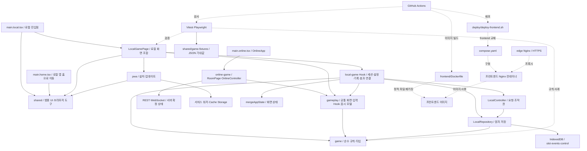

# ARCHITECTURE

## 개요

실물 카드 게임의 칩·베팅 순서·팟·수동 정산을 관리하는 React/TypeScript 앱이다.
현재 단일 기기 모드는 브라우저 IndexedDB에 게임과 기록을 보관하며 오프라인 PWA로 실행된다.
온라인 모드는 실제 서버의 REST·WebSocket으로 방과 게임을 공유한다. 공통 게임 UI와 로컬·온라인 운영 코드는 분리되어 있다.
이 문서는 현재 코드의 지도이며, 제품 요구와 규칙 상세는 [SPEC_INDEX.md](SPEC_INDEX.md)에서 찾는다.

## 전체 구조도

실선은 소스의 의존·호출 방향, 점선은 검사·빌드·배포의 연결이다.
브라우저 저장소와 서비스 워커는 실행 환경이며 애플리케이션 소스 폴더가 아니다.



화면에서 사용하는 규칙 계산과 저장소에서 수행하는 최종 규칙 검증은 목적이 다르다.
입력 가능 여부·미리보기는 화면을 돕고, 확정 상태 변경은 저장소의 명령 처리에서 수행한다.

## 디렉터리 지도

버전 관리되는 주요 디렉터리와 변경의 출발점만 정리한다.
파일 목록 전체나 제품 기획의 목차를 대신하지 않는다.

### 저장소 최상위

| 위치        | 역할 한 줄                              | 핵심 파일·심볼                                                                                                      |
| ----------- | --------------------------------------- | ------------------------------------------------------------------------------------------------------------------- |
| `frontend/` | 브라우저 앱·테스트·정적 이미지 빌드     | [package.json](frontend/package.json), [vite.config.ts](frontend/vite.config.ts), [Dockerfile](frontend/Dockerfile) |
| `backend/`  | 서버 Gradle 프로젝트: 규칙 `game`, JSON 변환 `game-json`, 앱 `server`, 이미지 빌드 | [settings.gradle.kts](backend/settings.gradle.kts), [Dockerfile](backend/Dockerfile), `backend/game/`, `backend/game-json/`, `backend/server/` |
| `shared/`   | 언어에 독립적인 규칙 테스트 입력·기대값과 API 예시 | `shared/game-fixtures/`, [schema.json](shared/game-fixtures/schema.json), [shared/api-contract/](shared/api-contract/README.md) |
| `deploy/`   | 프런트엔드 교체·복구와 edge 구성        | [deploy-frontend.sh](deploy/deploy-frontend.sh), [README.md](deploy/README.md)                                      |
| `.github/`  | 검사·이미지 발행·배포·연결 확인 자동화  | [ci-images.yml](.github/workflows/ci-images.yml), [backend-ci.yml](.github/workflows/backend-ci.yml), [check-server.yml](.github/workflows/check-server.yml) |
| `docs/`     | 책임별 리팩터링 계획과 검증 기록        | `docs/superpowers/plans/`                                                                                           |

루트 `shared/`는 프런트엔드와 향후 서버가 함께 쓰는 규칙 사례이고, `frontend/src/shared/`는 프런트엔드 범용 코드다. 이름은 같지만 다른 것이다.
루트의 [compose.yaml](compose.yaml)은 프런트엔드·백엔드 컨테이너와 외부 네트워크·자산 볼륨·배포 게이트 디렉터리를 연결한다.
edge 구성은 [deploy/edge/compose.yaml](deploy/edge/compose.yaml)로 별도 관리한다.
애플리케이션 명세의 입구는 [SPEC_INDEX.md](SPEC_INDEX.md), 작업 지침은 [AGENTS.md](AGENTS.md)다.
기술 선택의 이유는 [TECH_DECISIONS.md](TECH_DECISIONS.md), 실제 작업 이력은 [IMPLEMENTATION_PROGRESS.md](IMPLEMENTATION_PROGRESS.md)에 있다.

### 프런트엔드 진입과 규칙

| 위치                     | 역할 한 줄                                  | 핵심 파일·심볼                                                                                                                     |
| ------------------------ | ------------------------------------------- | ---------------------------------------------------------------------------------------------------------------------------------- |
| `frontend/src/`          | 진입점별 React 시작과 기능 모듈의 루트      | [main.local.tsx](frontend/src/main.local.tsx), `main.online.tsx`, `main.home.tsx`, [README.md](frontend/src/README.md)             |
| `frontend/src/app/`      | 공통 시작 처리와 앱 홈 | [mount.tsx](frontend/src/app/mount.tsx): `mount`; `HomeRedirect`                                              |
| `frontend/src/game/`     | UI·저장소와 독립적인 게임 상태·규칙         | [types.ts](frontend/src/game/types.ts): `GameState`, `GameCommand`; [transition.ts](frontend/src/game/transition.ts): `transition` |
| `frontend/src/features/` | 공통 게임 기능과 모드별 운영의 경계         | `frontend/src/features/gameplay/`, `frontend/src/features/local-game/`, `frontend/src/features/pwa/`                               |

HTML마다 자기 진입점을 로드한다. `local/index.html`은 [main.local.tsx](frontend/src/main.local.tsx), `online/index.html`은 `main.online.tsx`, 루트 `index.html`은 `main.home.tsx`다.
세 진입점 모두 [mount.tsx](frontend/src/app/mount.tsx)의 `mount`로 `installZoomPolicy`를 설치하고 React 루트를 만든다.
`/local/`은 앱 홈과 단일 기기 게임을 조합하는 `LocalGamePage`, `/online/`은 `OnlineApp`이며 `/`는 `/local/`로 문서 이동한다. 모드를 고르는 앱 홈은 `/local/`에 있다.
진입점이 나뉘어 온라인 번들에는 로컬 저장소·PWA 등록 코드가 들어가지 않는다. 온라인은 공통 게임 화면을 사용하고 라우터 라이브러리 없이 방 수명을 관리한다.

게임 설정은 [settings.ts](frontend/src/game/settings.ts)의 `GameSettings`와 `validateSettings`에서 시작한다.
턴과 딜러 위치는 [positions.ts](frontend/src/game/positions.ts)의 `nextSeat`, `nextPositions`가 계산한다.
첫 핸드의 SB·BB는 `initialBlindSeats`가 정하며 규칙과 준비 화면 표시가 같이 쓴다.
상태 전이는 `createTournament`, `getLegalActions`, `transition`에 모여 있다.
`transition`은 명령별 처리기를 고르는 입구다. 처리기는 `commands/`의 [setup.ts](frontend/src/game/commands/setup.ts)·[betting.ts](frontend/src/game/commands/betting.ts)·[flow.ts](frontend/src/game/commands/flow.ts)에 있다.
핸드 진행 보조(납부·라운드·스트리트·지급)는 [round.ts](frontend/src/game/round.ts), 거절 처리는 [rule.ts](frontend/src/game/rule.ts)의 `requireRule`이다.
`GameCommand`는 명령마다 필드가 정해진 판별 유니온이며, 처리기 목록은 모든 명령을 갖도록 타입으로 강제된다.
베팅 초안 금액을 명령으로 바꾸는 분류는 [draft.ts](frontend/src/game/draft.ts)의 `classifyDraft`가 맡는다.
팟·지급은 [settlement.ts](frontend/src/game/settlement.ts), 무결성 검사는 [invariants.ts](frontend/src/game/invariants.ts)가 담당한다.
규칙은 문장 대신 [errors.ts](frontend/src/game/errors.ts)의 거절 코드를 반환한다.
화면 문구는 [errorMessages.ts](frontend/src/features/gameplay/model/errorMessages.ts)의 `messageFor`가 만든다.

### 모드 공통 게임 기능

| 위치                                         | 역할 한 줄                                   | 핵심 파일·심볼                                                                                                                                                                                                           |
| -------------------------------------------- | -------------------------------------------- | ------------------------------------------------------------------------------------------------------------------------------------------------------------------------------------------------------------------------ |
| `frontend/src/features/gameplay/`            | 모드가 제공한 값과 콜백으로 게임 UI 구성     | [GameScreen.tsx](frontend/src/features/gameplay/GameScreen.tsx): `GameScreen`; [session.ts](frontend/src/features/gameplay/session.ts): `GameSession`                                                                    |
| `frontend/src/features/gameplay/components/` | 테이블·입력·기록·정산 표현                   | [Table.tsx](frontend/src/features/gameplay/components/Table.tsx), [PlayerSeat.tsx](frontend/src/features/gameplay/components/PlayerSeat.tsx), [BoardCards.tsx](frontend/src/features/gameplay/components/BoardCards.tsx) |
| `frontend/src/features/gameplay/hooks/`      | 입력 초안·준비 편집·승자 선택·드래그·칩 효과 | [useBettingDraft.ts](frontend/src/features/gameplay/hooks/useBettingDraft.ts), [useSettlementSelection.ts](frontend/src/features/gameplay/hooks/useSettlementSelection.ts), `useSeatDrag`, `useChipMotion`               |
| `frontend/src/features/gameplay/model/`      | 화면용 데이터·배치·기록 변환                 | [tableView.ts](frontend/src/features/gameplay/model/tableView.ts): `buildTableView`; [history.ts](frontend/src/features/gameplay/model/history.ts): `historyRows`                                                        |
| `frontend/src/features/gameplay/styles/`     | 게임 화면과 컨트롤 스타일                    | [header.css](frontend/src/features/gameplay/styles/header.css): 게임 헤더; [table.css](frontend/src/features/gameplay/styles/table.css), [controls.css](frontend/src/features/gameplay/styles/controls.css)              |

`GameScreen`은 헤더·`Table`·하단 독의 상태별 분기·게임 대화상자와 UNDO 처리를 조립한다.
모드는 `GameSession`(상태·잠금 여부·권한·허용 행동·화면 기준 좌석·조작 scope·`run`·`dispatch`·`notify`·`loadEvents`)과 준비 편집 콜백, 관리 메뉴 슬롯을 넘긴다.
화면 기준 좌석 `viewSeat`은 게임 상태가 아니라 화면 값이다. 로컬은 고른 회전을, 온라인은 보는 사람의 자기 좌석을 넘긴다.
권한은 [capabilities.ts](frontend/src/features/gameplay/model/capabilities.ts)의 `GameCapabilities`이며 로컬은 `fullCapabilities`를 넘긴다.
`Table`은 좌석 배치·중앙 조작·팟 탐색을 담당하고, 카드 글자 맞춤은 범용 `useFitText`를 쓴다.
준비 편집 조작은 `Table`의 `setup` prop 하나로 받으며, 이 값이 있을 때만 편집 화면이 된다.
`PlayerSeat`는 카드 표현과 이름 편집 연결을, `BoardCards`는 보드 표시와 등장 애니메이션을 담당한다.
[InlineName.tsx](frontend/src/features/gameplay/components/InlineName.tsx)는 이름 문자열·IME·저장 완료 순서를 다룬다.
[BlindSettings.tsx](frontend/src/features/gameplay/components/BlindSettings.tsx)는 초기 SB·BB와 저장 콜백만 받는다.
표시용 좌석 좌표는 [seatLayout.ts](frontend/src/features/gameplay/model/seatLayout.ts)의 `seatCoordinates`를 함께 사용한다.

### 온라인 운영과 서버 연결

| 위치 | 책임과 핵심 파일 |
|---|---|
| `features/online-game/OnlineApp.tsx`, `RoomPage.tsx` | 입장·복구·종료 단계와 공통 게임 화면·관리 메뉴 조합 |
| `hooks/useOnlineController.ts` | React 구독, 자동 복귀, 문서 종료와 BFCache 수명 |
| `session/onlineController.ts` | 서버 스냅샷, 조작 세대·순번·결과 불명 요청 한 건, 재연결 실패 시 방·세션 확인, 세션 갱신 |
| `session/roomMemory.ts`, `eventMemory.ts`, `recoveryPoller.ts` | 탭·브라우저 저장값, 알림용 최근 이벤트, 복구 결과 조회 |
| `api/client.ts`, `api/types.ts` | 메모리 CSRF 토큰·화면 스트림·REST와 수신 계약 검사 |
| `realtime/roomSocket.ts` | 구독·PING/PONG·RESYNC·지터 재연결·오프라인 잠금·화면 복귀 |
| `hooks/useOnlineGameSession.ts`, `model/` | 서버 상태와 허용 행동을 GameSession으로 변환, 명령·기록 문구 매핑 |
| `hooks/useOnlineChipMotion.ts`, `components/` | 연속 확정 이벤트 효과, 대기방·연결 안내·관리·결과 UI |

명령은 `GameScreen → GameSession.dispatch → toServerCommands → OnlineController → ApiClient → 서버 CommandPipeline` 순서다. 서버 응답이나 SNAPSHOT을 받은 뒤에만 잔액과 팟을 적용한다. 결과 불명 요청은 메모리에서 같은 식별자·순번·본문을 유지하고, 재연결 후 원장을 먼저 조회한다. 요청과 인증값·순번은 브라우저 저장소에 영속화하지 않는다.

`onObserved`는 서버 이벤트 ID를 중복 제거하여 자동 행동·취소 알림과 취소 입력 초기화를 전달한다. HTTP가 먼저 같은 버전을 적용했어도 같은 tuple의 WebSocket 이벤트 알림은 한 번 전달하되 상태를 다시 적용하지 않는다. 낮은 tuple은 이벤트까지 무시한다. `onConfirmed`는 연속 버전의 칩 효과만 전달하며, 버전이 건너뛰면 알림은 가능해도 칩 효과를 재생하지 않는다.

한 발행에 포함된 자동 행동과 취소 알림은 같은 토스트에 순서대로 표시한다. 온라인 보드는 화면에 표시한 버전에서 이어지는 발행에서만 새 카드를 애니메이션한다. 컨트롤러는 요청을 보낼 때의 토너먼트 범위를 기억한다. 응답 전에 범위가 바뀌면 요청 결과만 확정하고 이전 상태는 적용하지 않는다. 같은 자리에서 이미 관찰한 조작 세대도 되돌리지 않는다.

| 상태 | 소유자 |
|---|---|
| 잔액·팟·차례·권한·명단·정산 확정 | 서버 방과 게임 엔진 |
| 화면 버전·연결·조작 세대·미확정 요청·최근 이벤트 | OnlineController |
| CSRF·스트림 ID | ApiClient 메모리 |
| 베팅 입력·승자 선택 표시·대화상자·효과 | 공통 Hook과 온라인 화면 |
| 마지막 방 ID·코드 / 이 탭의 자동 인수 표시 | localStorage / sessionStorage (인증 정보 아님) |

실제 문서 종료는 `pagehide`에서 keepalive 스트림 삭제를 요청한다. BFCache 진입은 스트림과 결과 불명 요청을 보존하고 소켓만 닫으며, 복귀는 세션 갱신·재구독·원장 조회를 이어간다. 새 탭은 관전으로 시작하고 이 탭의 표시가 있는 새로고침만 자동 인수한다.

### 로컬 운영과 저장

| 위치                                           | 역할 한 줄                           | 핵심 파일·심볼                                                                                                                                                                                         |
| ---------------------------------------------- | ------------------------------------ | ------------------------------------------------------------------------------------------------------------------------------------------------------------------------------------------------------ |
| `frontend/src/features/local-game/`            | 로컬 화면과 복구 수명 조합           | [LocalGamePage.tsx](frontend/src/features/local-game/LocalGamePage.tsx): `LocalGamePage`, `LocalGame`                                                                                                  |
| `frontend/src/features/local-game/components/` | 로컬 홈·관리 메뉴                    | [LocalHome.tsx](frontend/src/features/local-game/components/LocalHome.tsx), [ManagerMenu.tsx](frontend/src/features/local-game/components/ManagerMenu.tsx)                                             |
| `frontend/src/features/local-game/hooks/`      | 로컬 세션·인원·회전·효과 연결        | [useLocalSession.ts](frontend/src/features/local-game/hooks/useLocalSession.ts), `useLocalSetupExtras`, `useLocalChipMotion`                                                                           |
| `frontend/src/features/local-game/model/`      | 로컬 화면 상태와 명령 기반 효과 계산 | [appState.ts](frontend/src/features/local-game/model/appState.ts): `AppState`, `mergeAppState`; [localChipTransfers.ts](frontend/src/features/local-game/model/localChipTransfers.ts): `chipTransfers` |
| `frontend/src/features/local-game/storage/`    | 조작권·요청·검증·IndexedDB 원자 저장 | [controller.ts](frontend/src/features/local-game/storage/controller.ts): `LocalController`; [repository.ts](frontend/src/features/local-game/storage/repository.ts): `LocalRepository`                 |

`LocalGamePage`는 복구를 위해 자식 로컬 게임을 다시 만들 때도 유지할 상태를 가진다.
내부 `LocalGame`은 세션·준비 편집·PWA·알림을 `GameSession`으로 묶어 `GameScreen`에 넘긴다.
로딩·복원 오류 화면, 로컬 오류 배너, 홈, 업데이트 대화상자와 토스트 표시는 이 페이지에 남는다.
`useLocalSession`은 세션 실행 중 저장소·컨트롤러와 실행 잠금을 관리한다.
탭 사이 알림은 `useCrossTabOwnership`, 페이지 복귀 감지는 `usePageResume`이 맡는다.
실행 잠금은 [commandRunner.ts](frontend/src/shared/async/commandRunner.ts)의 `createCommandRunner`이며, 삭제 확인 창은 페이지가 `ask` 콜백으로 넘긴다.
저장소의 요청·결과·조작권 타입은 [types.ts](frontend/src/features/local-game/storage/types.ts)에 있다.
`LocalController`는 현재 상태·조작권·미확정 요청·요청 순번을 보관한다.
`LocalRepository`는 규칙 실행과 상태·이벤트·조작권 기록의 커밋 경계다.

[database.ts](frontend/src/features/local-game/storage/database.ts)의 `openDatabase`가 저장소를 연다.
[restore.ts](frontend/src/features/local-game/storage/restore.ts)의 `validateStored`가 저장 형식과 게임 무결성을 검사한다.
[storageDeadline.ts](frontend/src/features/local-game/storage/storageDeadline.ts)의 `storageDeadline`은 무응답 작업의 대기를 제한한다.
화면 복원은 최신 상태를 읽으며, 기록 전체를 재생해 게임을 재구축하지 않는다.

### PWA와 범용 코드

| 위치                           | 역할 한 줄                                | 핵심 파일·심볼                                                                                                                                                                      |
| ------------------------------ | ----------------------------------------- | ----------------------------------------------------------------------------------------------------------------------------------------------------------------------------------- |
| `frontend/src/features/pwa/`   | 설치·업데이트의 브라우저 처리와 안내 정책 | [register.ts](frontend/src/features/pwa/register.ts): `useLocalPWA`; [usePwaPresentation.ts](frontend/src/features/pwa/usePwaPresentation.ts), `useInstallPrompt`, `checkForUpdate` |
| `frontend/src/shared/`         | 게임·모드와 독립적인 UI·브라우저 도구     | `Dialog`, `useScreenFit`, `useFitText`, `installZoomPolicy`                                                                                                                         |
| `frontend/src/shared/ui/`      | 공통 대화상자와 닫기 동작                 | [Dialog.tsx](frontend/src/shared/ui/Dialog.tsx): `Dialog`                                                                                                                           |
| `frontend/src/shared/hooks/`   | 화면·대화상자의 크기 맞춤, 토스트 타이머  | [useScreenFit.ts](frontend/src/shared/hooks/useScreenFit.ts): `useScreenFit`; [useToast.ts](frontend/src/shared/hooks/useToast.ts): `useToast`                                      |
| `frontend/src/shared/browser/` | 브라우저 확대 입력 정책                   | [zoomPolicy.ts](frontend/src/shared/browser/zoomPolicy.ts): `installZoomPolicy`                                                                                                     |
| `frontend/src/shared/styles/`  | 전역 토큰과 기본 스타일                   | [tokens.css](frontend/src/shared/styles/tokens.css): `:root` 변수; [base.css](frontend/src/shared/styles/base.css): 요소 기본값·전역 레이아웃 (이 순서로 로드)                      |

[vite.config.ts](frontend/vite.config.ts)가 서비스 워커 생성과 HTML 빌드 진입점을 정한다.
로컬 manifest는 [manifest.webmanifest](frontend/public/local/manifest.webmanifest)에 있다.
PWA 등록은 로컬 게임에서 호출하는 `useLocalPWA`가 담당한다.
업데이트·설치 안내를 언제 보여줄지는 `usePwaPresentation`이 결정한다.

## 백엔드 규칙 모듈 (`backend/game`)

서버의 순수 게임 규칙이다. 프런트 `frontend/src/game/`을 Java 25로 옮긴 것이며 같은 공통 사례를 통과해야 한다.
방·API·인증은 `backend/server`가 이 모듈을 호출한다(아래 서버 앱 절).
패키지 `xyz.jwlee.poker.game` 아래 구조는 다음과 같다.

| 위치 | 역할 한 줄 |
| ---- | ---------- |
| `GameEngine` | 유일한 진입점 `transition(상태, 명령, 문맥)`. 상태를 복사해 명령을 적용하고 `TransitionResult`를 반환 |
| `TransitionResult` | `Applied(상태, 이벤트)` 또는 `Rejected(오류 코드)` |
| `Round` | 베팅 라운드 진행·핸드 시작·정산·탈락 처리 |
| `Legal`, `LegalActions`, `LegalReasonCode` | 현재 차례의 합법 행동(콜 금액·최소 레이즈·체크/콜/레이즈 가능) |
| `Settlement`, `SettlementPreview`, `PotAllocation` | 메인·사이드 팟 구성, 승자별 지급 미리보기와 나머지 칩 배분 |
| `Positions` | 딜러·SB·BB와 헤즈업 위치, 다음 좌석 계산 |
| `Invariants` | 모든 성공 전환 뒤 칩 총량·팟 장부·차례 검사 |
| `Tournament` | 설정 검증 후 준비 단계 상태 생성(`create`) |
| `model/` | `GameState`·`Player`·`Hand`·`Pot`·`GameSettings`·`UndoSnapshot` 등 상태 모델과 `copy()` |
| `command/` | `GameCommand` record와 명령별 처리기: `SetupCommands`·`BettingCommands`·`FlowCommands`·`ForfeitCommand`, 공통 검사 `HandGuard` |
| `event/` | `GameEvent`와 종류별 record `EventDetails`(sealed) |
| `rule/` | `Rules.require`, `RuleViolation`, `RuleErrorCode`, `SettlementErrorCode` |
| `settings/` | `SettingsValidator`와 결과 `SettingsValidation`, `SettingsErrorCode` |

### TS 파일 ↔ Java 클래스

| `frontend/src/game/` | `backend/game/.../game/` |
| -------------------- | ------------------------ |
| `types.ts` | `model/*`, `command/GameCommand`, `event/*` |
| `transition.ts` (`transition`·`undoable`) | `GameEngine` |
| `tournament.ts` | `Tournament` |
| `commands/setup.ts` | `command/SetupCommands` |
| `commands/betting.ts` | `command/BettingCommands` |
| `commands/flow.ts` | `command/FlowCommands` |
| (없음, 서버 전용) | `command/ForfeitCommand` |
| `round.ts` | `Round` |
| `legal.ts` | `Legal`, `LegalActions`, `LegalReasonCode` |
| `settlement.ts` | `Settlement`, `SettlementPreview`, `PotAllocation` |
| `positions.ts` | `Positions` |
| `settings.ts` | `settings/*` |
| `invariants.ts` | `Invariants` |
| `rule.ts`, `errors.ts` | `rule/*`, `settings/SettingsErrorCode`, `LegalReasonCode` |
| `draft.ts` | (없음, 입력 초안은 화면 전용) |

### 의존 방향과 실행

- `backend/game`의 main 의존성은 JDK뿐이다. 별도 Gradle 모듈이므로 Spring·서버 코드를 import하면 컴파일이 실패한다.
  테스트 라이브러리(JUnit·AssertJ·Jackson)는 test 범위에만 있다. 버전은 [TECH_DECISIONS.md](TECH_DECISIONS.md) T60에 있다.
- 상태 변경은 TS와 같이 명령마다 깊은 복사 후 복사본만 수정한다. 거절은 `RuleViolation`으로만 하고 다른 예외는 버그로 전파한다.
- 필드명은 풀어 쓴다(`roundBet`=B, `handTotal`=H, `currentBet`=W, `minRaise`=R). JSON 이름 변환은 `game-json` 모듈의 `GameJson`·`EventJson` 한 곳에서만 한다(서버도 재사용).
- `FORFEIT`는 서버 전용 규칙이다. 누가 누구를 기권시킬 수 있는지는 후속 방 계층이 검사하고 이 규칙은 대상이 나갈 수 있는지만 확인한다.
- 공통 사례 형식 v2: 시작 상태는 완전한 GameState JSON이고 명령 목록과 `expectError`·`expectedStateSubset`·`expectRestores`가 이어진다.
  의미의 기준은 [schema.json](shared/game-fixtures/schema.json)의 description이다. `forfeit.json`은 Java 전용이다.
- 테스트는 `backend/game/src/test/java/xyz/jwlee/poker/game/`에 있다. `fixtures/`의 `FixtureFiles`·`JsonSubset`·`FixtureRunner`와 `*FixtureTest`가 공통 사례를 읽고, `RandomTournamentTest`는 고정 시드(20261029)의 2~10인 토너먼트를 기권 포함 무작위 명령으로 끝까지 진행하며 매 전환의 불변식·입력 불변을 검사한다.

```powershell
backend/gradlew -p backend :game:test
```

## 백엔드 서버 앱 (`backend/server`)

Spring Boot 4·Spring MVC·가상 스레드 앱이다. 방은 서버 메모리에만 있다. 게임 변경은 REST로 받고(계획 2A), 상태 전달·연결 판정·방 수명·기기 복구는 WebSocket과 예약 작업이 맡는다(계획 2B).
프런트엔드 온라인 화면은 이 서버에 연결되어 있다(계획 3). 서버 배포·운영 설정은 아직 없다(계획 4).
패키지 `xyz.jwlee.poker.server` 아래 구조는 다음과 같다.

| 위치 | 역할 한 줄 |
| ---- | ---------- |
| `api/` | `RoomController`(생성·참가·상태), `CommandController`(명령·요청 결과·조작 인수), `RecoveryController`(복구 신청·결과 조회), `HistoryController`, `HealthController`, 본문 크기 필터, `ApiExceptionHandler`·`ApiError`(코드·HTTP 상태·문구) |
| `auth/` | `SecurityConfig`, `OriginFilter`, `SessionGuardFilter`, `SessionController`(세션·스트림), `SessionIdentity`(세션 속성·스트림 장부의 유일한 입구, 방별 `SeatBinding` 보관), `WebSocketHandshakeGuard`(핸드셰이크의 Origin·세션 검사) |
| `realtime/` | `RealtimeConfig`(`/ws` 등록), `RoomSocketHandler`(소켓 열림·닫힘, SUBSCRIBE·PONG·RESYNC), `ConnectionHub`(열린 연결 표, `RoomPublisher` 구현), `Connection`(소켓 하나의 전송 대기열), `HeartbeatTask`(1초 주기 PING·무응답·전송 정체·미구독 정리), `SweepTask`(1초 주기 방 점검), `SessionExpiryListener`(세션이 끝나면 연결 회수) |
| `room/` | `Room`(방 상태·잠금), `CommandPipeline`(검사 순서와 명령 연결), `WaitingRoomCommands`·`GameCommands`·`ResultCommands`·`RecoveryCommands`, `RoomLifecycle`(연결 전환·시간 규칙), `Presence`(참가자별 구독 연결·끊김 시각), `AutoPlay`(끊긴 사람의 자동 체크·폴드), `RecoveryRequests`, `SeatBinding`(자리와 자격의 묶음), `StartConditions`, `StartGate`(배포 중 새 게임 차단), `Capabilities`, `RequestLedger`·`RequestOutcome`, `SnapshotWriter`, `PublicationBuilder`·`Publication`·`RoomPublisher`(방 변경을 수신자별 메시지로 모으는 경계) |
| `registry/` | `RoomRegistry`(방 표·한도·코드·잠금 진입, 배포 준비), `RoomCodes` |
| `ops/` | `DeployController`(내부 배포 경로), `LoopbackOnlyFilter`(내부 경로의 loopback 제한), `GateFile`(기동 때 시작 차단 파일 판정) |
| `support/` | `IdGenerator`, `Clock` 빈, `Protocol` |

### 의존 방향과 잠금

- `api`·`auth`·`realtime`·`ops` → `room`·`registry` → `game`·`game-json`. `ops`는 `room`·`registry`만 쓰고 어떤 패키지도 `ops`를 쓰지 않는다. `realtime`은 `auth`를 쓸 수 있고 `realtime`과 `api`는 서로 쓰지 않는다. `auth`도 `realtime`을 모르므로 `SessionExpiryListener`는 `realtime`에 있다. `room`·`registry`는 `api`·`auth`·`realtime`·Spring Web·Spring WebSocket·Servlet을 쓰지 않고 `support`는 다른 서버 패키지를 쓰지 않는다. [ArchitectureTest](backend/server/src/test/java/xyz/jwlee/poker/server/ArchitectureTest.java)가 검사한다.
- 잠금 순서는 스트림 장부 → 공용 잠금 → 방 잠금 → 세션 모니터다. 역순으로 잡지 않는다. `RoomRegistry.withRoom`의 작업 안에서 공용 잠금을 부르지 않는다. 방 삭제는 방 잠금 안에서 닫고, 푼 뒤에 표에서 뺀다.
- 배포 준비는 공용 잠금 안에서 게이트를 먼저 닫고 방 잠금으로 진행 여부를 확인한다. START와 결과 화면 UNDO는 방 잠금 안에서 게이트를 읽는다. 근거는 `RoomRegistry.prepareDeployment` 주석이 기준이다. 스냅샷의 `deployPending`은 방 필드이고 공용 잠금을 푼 뒤 `update`로 바뀌어 버전과 함께 움직인다.
- 명령 검사 순서는 `CommandPipeline` 주석이 기준이다: 형식 → 방 → 참가자 → 조작 세대 → 중복 → 권한 → 토너먼트·핸드 → 상태 버전 → 규칙.
- 생성·참가·인수는 세션 스트림 장부, 게임 명령은 참가자·조작 세대별 장부를 쓴다. 세대 장부는 현재와 직전만 보관한다.
- 명령의 CONTROL_LOST(세대 장부)는 순번을 소진하지 않는 유일한 비즈니스 거절이다. `/control`의 CONTROL_LOST는 세션 스트림 장부에 기록되어 순번을 소진한다. 인수는 room version을 올리지 않는다. 승자 초안도 room version 대신 자기 `draftVersion`을 쓰므로 상태 버전 검사를 건너뛴다. 핸드 범위 검사는 받는다.
- 세션 스트림은 `DELETE /api/session/streams/{streamId}`로 닫는다. `StartConditions`의 전원 연결은 `Presence`의 실제 판정이다.

### 잠금과 전송의 경계

- 방을 바꾸는 경로는 모두 `RoomRegistry.update`를 지난다. 작업이 끝나면 방 잠금 안에서 `PublicationBuilder.collect`가 수신자별 메시지를 만들고, 잠금을 푼 뒤 `RoomPublisher.publish`로 넘긴다. 시간 규칙의 `sweepAll`과 닫힌 방의 표 제거도 같은 길이다. 응답 기록은 장부 잠금 안에서 끝나므로 발행은 장부 잠금 안일 수 있고, 그래서 `ConnectionHub.publish`는 대기열에 넣기만 하고 바로 돌아온다.
- 소켓 전송은 `Connection`마다 가상 스레드 하나가 한다. 대기는 진행 중 1개, PING 1개, 최신 스냅샷 1개, 마지막 메시지 1개뿐이다. 중간 스냅샷은 대체되고, 발행 순서가 뒤바뀌어도 `(stateVersion, draftVersion)`이 낮은 스냅샷은 버린다. 같은 값은 새 시점의 화면(RESYNC·조작 인수)일 수 있어 보낸다. 화면은 낮은 쌍을 버리고 같은 쌍은 `previousVersion`이 `null`일 때만 효과 없이 적용한다. ACCESS_REVOKED·ROOM_GONE·PROTOCOL_INCOMPATIBLE은 대체되지 않고 이것을 보낸 뒤 1000으로 닫는다. 마지막 메시지 없이 닫는 연결은 1001이고, 재연결 여부는 코드가 아니라 마지막 메시지로 정한다.
- 전송 실패는 연결을 닫을 뿐 게임 변경을 되돌리지 않는다. 등록되지 않았거나 회수된 연결로 가는 전달은 버린다.
- 구독은 방 잠금 안에서 자리 자격·연결 한도를 확인하고 `connected`와 첫 스냅샷 예약까지 한 번에 처리한다. 닫힘과 겹치면 먼저 방을 기록하고 잠금 안에서 닫힘을 확인하는 순서로, 닫힌 연결이 붙은 채 남지 않게 한다. RESYNC와 두 번째 SUBSCRIBE도 자리 자격을 다시 확인한다.
- 연결 상태 전환, 방장 인수 요청 열림, 복구 신청 생성은 상태 버전을 올린다. 생존 응답과 조작 화면 인수는 올리지 않는다. 인수 뒤에는 그 참가자의 연결마다 `previousVersion: null`인 스냅샷을 같은 버전으로 다시 보내 새 `controlGeneration`을 알린다. 30분 미접속으로 방을 닫을 때도 올리지 않는다. 볼 사람이 없고 ROOM_GONE에는 버전이 없기 때문이다.
- 참가자를 명단에서 뺄 때 `Presence.forget`이 돌려준 연결은 `revokedConnections`로 나가 ACCESS_REVOKED를 받는다. 복구 승인도 같은 길로 옛 연결을 닫고 `Presence.forget`·`Presence.joined`로 첫 연결 대기를 다시 건다. 승인 때 대상이 차례이면 `AutoPlay`가 바로 처리한다. 첫 연결 전인 사람은 다시 준비 뒤에도 30초 대기를 유지한다. 방장 인수 요청은 방장 본인이 돌아올 때만 닫힌다.

### 경로

| 경로 | 처리 |
| ---- | ---- |
| `GET /api/health` | 상태·프로토콜·빌드 버전 |
| `POST /internal/deploy/prepare`, `GET /internal/deploy/status`, `POST /internal/deploy/release` | 배포 준비·상태·해제. loopback 전용이고 비loopback은 404, CSRF·Origin·세션 검사 없음 |
| `GET /api/session`, `POST /api/session/refresh`, `POST /api/session/streams`, `DELETE /api/session/streams/{streamId}` | 세션·CSRF 토큰, 쿠키 연장, 화면 스트림 |
| `POST /api/rooms`, `POST /api/room-joins` | 방 생성, 코드로 참가 |
| `GET /api/rooms/{roomId}/state` | 요청자별 스냅샷 |
| `POST /api/rooms/{roomId}/commands` | 대기방·게임·결과 명령 |
| `GET /api/rooms/{roomId}/requests/{requestId}` | 저장된 요청 결과 |
| `POST /api/rooms/{roomId}/control` | 같은 참가자의 다른 화면으로 조작 인수 |
| `GET /api/rooms/{roomId}/history` | 현재 토너먼트 기록 |
| `POST /api/recovery-requests`, `GET /api/recovery-requests/{id}` | 새 기기의 복구 신청, 자기 신청의 결과 조회(승인이면 세션을 자리에 연결) |
| `GET /ws` | WebSocket. 핸드셰이크에서 Origin·세션을 보고 메시지마다 자리 자격을 다시 본다 |

요청·응답·소켓 메시지의 실제 예시는 [shared/api-contract/](shared/api-contract/README.md)에 있고 [ApiContractTest](backend/server/src/test/java/xyz/jwlee/poker/server/api/ApiContractTest.java)가 실제 응답과 비교한다. 명세와 다른 곳은 [SYSTEM_SPEC.md](SYSTEM_SPEC.md) 6·14절의 2A·2B 항목에 표시했다.

### 실행과 테스트

- `FullTournamentHttpTest`: 실제 포트·쿠키·CSRF·Origin과 실제 WebSocket, 세션 3개로 토너먼트 전체와 재시작. 화면마다 마지막 SNAPSHOT이 `GET state`와 같은지 본다.
- `DisconnectedTournamentHttpTest`: 시계만 진행시키고 실제 예약 작업이 반응하게 해 무응답 끊김·자동 처리·복귀, 방장 인수, 끊긴 사람의 기권 처리까지 진행한다.
- `RoomSocketHttpTest`·`RecoverySocketHttpTest`: 실제 포트의 핸드셰이크·구독·닫힘 코드·접근 회수.
- `RoomConcurrencyTest`: 같은 상태 버전 스레드 20개에서 적용 1개, 나머지 `STALE_STATE`, 칩 총량 보존.
- 그 밖의 API 테스트는 MockMvc, 쿠키·본문 크기 경계는 `RoomHttpTest`·`SessionSecurityHttpTest`의 실제 HTTP.

```powershell
backend/gradlew -p backend test
backend/gradlew -p backend :server:bootRun
```

## 기능 → 코드 위치 표

| 기능                               | 주요 파일                                                                                                                                                                                                                                                                                            | 핵심 함수·컴포넌트                                                        | 관련 명세                                                                |
| ---------------------------------- | ---------------------------------------------------------------------------------------------------------------------------------------------------------------------------------------------------------------------------------------------------------------------------------------------------- | ------------------------------------------------------------------------- | ------------------------------------------------------------------------ |
| 게임 준비·이름·딜러·좌석 편집      | [useSetupEditing.ts](frontend/src/features/gameplay/hooks/useSetupEditing.ts), [SetupPanel.tsx](frontend/src/features/gameplay/components/SetupPanel.tsx), [settings.ts](frontend/src/game/settings.ts)                                                                                              | `useSetupEditing`, `SetupPanel`, `validateSettings`                       | [UX_SPEC.md](UX_SPEC.md), [GAME_SPEC.md](GAME_SPEC.md)                   |
| 베팅 입력·콜·레이즈 가능 여부      | [useBettingDraft.ts](frontend/src/features/gameplay/hooks/useBettingDraft.ts), [BetControls.tsx](frontend/src/features/gameplay/components/BetControls.tsx), [transition.ts](frontend/src/game/transition.ts)                                                                                        | `useBettingDraft`, `BetControls`, `getLegalActions`                       | [GAME_SPEC.md](GAME_SPEC.md), [UX_SPEC.md](UX_SPEC.md)                   |
| 메인·사이드 팟과 미콜 반환         | [settlement.ts](frontend/src/game/settlement.ts), [round.ts](frontend/src/game/round.ts), [tableView.ts](frontend/src/features/gameplay/model/tableView.ts)                                                                                                                                          | `buildPots`, `returnUncalled`, `buildTableView`                           | [GAME_SPEC.md](GAME_SPEC.md)                                             |
| 승자 선택·동률·지급 미리보기·정산  | [useSettlementSelection.ts](frontend/src/features/gameplay/hooks/useSettlementSelection.ts), [PayoutPreview.tsx](frontend/src/features/gameplay/components/PayoutPreview.tsx), [settlement.ts](frontend/src/game/settlement.ts)                                                                      | `useSettlementSelection`, `previewSettlement`, `PayoutPreview`            | [GAME_SPEC.md](GAME_SPEC.md), [UX_SPEC.md](UX_SPEC.md)                   |
| 직전 행동 되돌리기                 | [transition.ts](frontend/src/game/transition.ts), [GameScreen.tsx](frontend/src/features/gameplay/GameScreen.tsx), [history.ts](frontend/src/features/gameplay/model/history.ts)                                                                                                                     | `transition`, `resetWinners`, `historyRows`                               | [GAME_SPEC.md](GAME_SPEC.md), [SYSTEM_SPEC.md](SYSTEM_SPEC.md)           |
| 다음 핸드 블라인드 예약            | [BlindSettings.tsx](frontend/src/features/gameplay/components/BlindSettings.tsx), [commands/flow.ts](frontend/src/game/commands/flow.ts)                                                                                                                                                             | `BlindSettings`, `transition`                                             | [GAME_SPEC.md](GAME_SPEC.md), [UX_SPEC.md](UX_SPEC.md)                   |
| 로컬 저장·이어하기·다른 탭 인수    | [useLocalSession.ts](frontend/src/features/local-game/hooks/useLocalSession.ts), [controller.ts](frontend/src/features/local-game/storage/controller.ts), [repository.ts](frontend/src/features/local-game/storage/repository.ts), [restore.ts](frontend/src/features/local-game/storage/restore.ts) | `useLocalSession`, `LocalController`, `LocalRepository`, `validateStored` | [SYSTEM_SPEC.md](SYSTEM_SPEC.md), [TECH_DECISIONS.md](TECH_DECISIONS.md) |
| 핸드 기록·역순·더 보기             | [useEventHistory.ts](frontend/src/features/gameplay/hooks/useEventHistory.ts), [eventPages.ts](frontend/src/features/gameplay/model/eventPages.ts), [history.ts](frontend/src/features/gameplay/model/history.ts), [HistoryPanel.tsx](frontend/src/features/gameplay/components/HistoryPanel.tsx)    | `useEventHistory`, `readAllEvents`, `historyRows`, `HistoryPanel`         | [UX_SPEC.md](UX_SPEC.md), [SYSTEM_SPEC.md](SYSTEM_SPEC.md)               |
| 보드·칩 이동 효과                  | [BoardCards.tsx](frontend/src/features/gameplay/components/BoardCards.tsx), [useLocalChipMotion.ts](frontend/src/features/local-game/hooks/useLocalChipMotion.ts), [useChipMotion.ts](frontend/src/features/gameplay/hooks/useChipMotion.ts)                                                         | `BoardCards`, `useLocalChipMotion`, `useChipMotion`                       | [UX_SPEC.md](UX_SPEC.md)                                                 |
| PWA 설치·오프라인·업데이트         | [register.ts](frontend/src/features/pwa/register.ts), [usePwaPresentation.ts](frontend/src/features/pwa/usePwaPresentation.ts), [vite.config.ts](frontend/vite.config.ts)                                                                                                                            | `useLocalPWA`, `usePwaPresentation`, `useInstallPrompt`                   | [TECH_DECISIONS.md](TECH_DECISIONS.md), [UX_SPEC.md](UX_SPEC.md)         |
| 화면 맞춤·입력 중 키보드·확대 정책 | [useScreenFit.ts](frontend/src/shared/hooks/useScreenFit.ts), [zoomPolicy.ts](frontend/src/shared/browser/zoomPolicy.ts)                                                                                                                                                                             | `useScreenFit`, `installZoomPolicy`                                       | [UX_SPEC.md](UX_SPEC.md)                                                 |
| 이미지 빌드·프런트엔드 배포·복구   | [ci-images.yml](.github/workflows/ci-images.yml), [Dockerfile](frontend/Dockerfile), [deploy-frontend.sh](deploy/deploy-frontend.sh)                                                                                                                                                                 | `checks`, `publish`, `deploy`, `healthy`, `activate`                      | [DEPLOYMENT_SPEC.md](DEPLOYMENT_SPEC.md), [배포 안내](deploy/README.md)  |

## 데이터·상태 흐름

### 상태의 소유자

| 상태                                    | 소유 위치                                                         | 저장 여부                 |
| --------------------------------------- | ----------------------------------------------------------------- | ------------------------- |
| 확정 게임·현재 핸드·되돌리기 스냅샷     | `GameState`; `LocalController`와 `useLocalSession`의 화면 반영 값 | IndexedDB                 |
| 조작 화면·세대·처리 순번·최근 요청 결과 | `LocalRepository`의 `ControlRecord`                               | IndexedDB                 |
| 저장 중·실패·조작권 상실·홈 여부        | `AppState`, `mergeAppState`                                       | React 메모리              |
| 베팅 금액·승자 선택·현재 팟             | `useBettingDraft`, `useSettlementSelection`                       | React 메모리              |
| 이름·숫자 문자열·IME 편집 상태          | `InlineName`, `SetupPanel`, `BlindSettings`                       | 컴포넌트 메모리           |
| 로컬 화면 기준 좌석(회전)               | `useLocalViewSeat`, `viewSeatStore`                               | localStorage (토너먼트별) |
| 복구 재생성 key·업데이트 안내 보류      | `LocalGamePage`                                                   | 부모 컴포넌트 메모리      |
| 열린 대화상자·토스트                    | `LocalGame`, `useToast`                                           | React 메모리              |

### 일반 명령 처리

1. 사용자가 `BetControls`, 준비 폼 또는 테이블 카드를 조작한다.
   공통 UI는 로컬 저장소를 호출하지 않고 전달받은 콜백을 실행한다.
2. `useBettingDraft`는 모드가 넘긴 허용 행동(`GameSession.legal`)으로 금액 초안을 관리한다.
   SUBMIT 금액은 `classifyDraft`가 `GameCommand` 또는 거절 코드로 바꾼다.
   준비 편집은 `useSetupEditing`, 승자 선택은 `useSettlementSelection`이 맡는다.
   인원 추가·삭제는 로컬 전용 `useLocalSetupExtras`에 있다.
   화면 회전은 명령·저장 없이 `useLocalViewSeat`이 localStorage에 기억한다. 예전 저장 데이터의 `settings.viewSeat`는 처음 한 번 초기값으로 이어받는다.
3. `GameScreen`이 `GameSession.guard`로 잠금을 확인하고 세션의 `run`, `dispatch`를 호출한다.
   로컬에서는 `useLocalSession`의 `run`, `dispatch`가 연결된다.
   이때 칩 이동용 좌표를 미리 준비하지만 확정 효과는 아직 재생하지 않는다.
4. `LocalController.dispatch`가 조작권·기대 버전·토너먼트·핸드·요청 순번을 묶어 `Request`를 만든다.
   처리 중인 요청이 있으면 새 요청을 시작하지 않는다.
5. `LocalRepository.dispatch`가 하나의 트랜잭션 안에서 조작권·중복·순번·기대 버전을 검사한다.
   일반 게임 명령은 `transition`을 호출하고, 새 토너먼트는 `createTournament`로 만든다.
6. 규칙 결과와 이벤트, 요청 처리 결과를 저장한 뒤 트랜잭션 완료를 기다린다.
   성공한 결과만 `APPLIED`로 반환하며 저장 결과를 확신할 수 없는 오류는 `UNKNOWN`으로 반환한다.
   `REJECTED`의 `reason`은 규칙·세션 거절 코드이며 화면은 `messageFor`로 안내한다.
7. `LocalController`가 확정 결과를 받아 상태와 미확정 요청을 갱신한다.
   `useLocalSession`이 `mergeAppState`를 통해 React 화면 상태에 반영한다.
8. `buildTableView`가 확정 상태와 현재 입력 초안을 화면 데이터로 변환한다.
   `Table`과 하위 카드가 다시 표시되고, 결과 버전이 맞는 경우 준비한 칩 효과를 재생한다.

### 실패·복원·기록

- `UNKNOWN`이면 기존 확정 상태를 유지하고 원래 `Request`를 보관한다.
  `retryStorage`는 `LocalController.retry`로 같은 요청을 재확인한다.
- 최근 결과가 보관된 동일 요청은 기존 결과를 반환한다.
  결과 보관에서 밀려난 과거 순번도 새 명령으로 재실행하지 않는다.
- 복원은 `LocalController.refresh` → `LocalRepository.load` → `validateStored`로 진행한다.
  최신 스냅샷과 조작권을 확인하며 저장 이벤트 전체를 재실행하지 않는다.
- 저장소 연결 변경·무응답은 `storageDeadline`과 복원 세대 검사로 다룬다.
  늦게 도착한 복원 결과는 현재 화면 상태를 덮어쓰지 않는다.
- 다른 탭의 변경 알림은 재조회 계기다.
  실제 쓰기 권한은 BroadcastChannel 메시지가 아니라 IndexedDB의 조작 세대로 검증한다.
- 기록 창이 열리면 `GameHistoryPanel`이 `useEventHistory`로 `GameSession.loadEvents`를 호출한다.
  `readAllEvents`가 시간순으로 100개씩 끝까지 모은 뒤 `historyRows`가 취소를 반영하고, `HistoryPanel`이 정렬·더 보기를 관리한다.
  로컬은 `LocalRepository.readEvents`를 넘기고, 온라인은 서버 조회를 넘긴다.

## 이걸 바꾸려면 여기를 본다

먼저 시작 파일을 읽고, 규칙 변경이면 공통 JSON 기대값과 관련 테스트까지 함께 확인한다.

| 수정 요청                               | 시작할 파일                                                                                                                                                                                                                                   | 함께 확인할 경계                                                                                   |
| --------------------------------------- | --------------------------------------------------------------------------------------------------------------------------------------------------------------------------------------------------------------------------------------------- | -------------------------------------------------------------------------------------------------- |
| 이름·시작 칩·참가자 수 검증 변경        | [settings.ts](frontend/src/game/settings.ts)                                                                                                                                                                                                  | `validateSettings`; 준비 UI와 복원 검증도 같은 규칙 사용                                           |
| 이름 편집·좌석 드래그·첫 딜러 조작 변경 | [useSetupEditing.ts](frontend/src/features/gameplay/hooks/useSetupEditing.ts), [InlineName.tsx](frontend/src/features/gameplay/components/InlineName.tsx)                                                                                     | IME, 저장 완료 순서, `useSeatDrag`                                                                 |
| 칩 버튼·BET 초안 동작 변경              | [useBettingDraft.ts](frontend/src/features/gameplay/hooks/useBettingDraft.ts), [BetControls.tsx](frontend/src/features/gameplay/components/BetControls.tsx)                                                                                   | `classifyDraft`와 최종 `transition` 검증의 일치 테스트를 함께 확인                                 |
| 콜·최소 레이즈·짧은 올인·턴 규칙 변경   | [commands/betting.ts](frontend/src/game/commands/betting.ts), [legal.ts](frontend/src/game/legal.ts), [round.ts](frontend/src/game/round.ts)                                                                                                  | `getLegalActions`, 공통 베팅 사례, 총량 불변 조건                                                  |
| 팟 분리·동률·나머지 칩 배분 변경        | [settlement.ts](frontend/src/game/settlement.ts)                                                                                                                                                                                              | `buildPots`, `previewSettlement`, 승자 선택 미리보기                                               |
| 무르기 범위나 취소 후 기록 변경         | [transition.ts](frontend/src/game/transition.ts) `undoable`, [commands/flow.ts](frontend/src/game/commands/flow.ts), [history.ts](frontend/src/features/gameplay/model/history.ts)                                                            | 스냅샷·이벤트 식별자와 `resetWinners`                                                              |
| 이어하기·조작권 인수·저장 재시도 변경   | [useLocalSession.ts](frontend/src/features/local-game/hooks/useLocalSession.ts), [repository.ts](frontend/src/features/local-game/storage/repository.ts)                                                                                      | `LocalController`, 동일 요청 보존, 트랜잭션 경계                                                   |
| 테이블·카드·보드 배치나 글자 크기 변경  | [Table.tsx](frontend/src/features/gameplay/components/Table.tsx), [table.css](frontend/src/features/gameplay/styles/table.css)                                                                                                                | `seatCoordinates`, `useScreenFit`, `useFitText`, DOM 선택자                                        |
| 칩 이동 금액 또는 효과 변경             | [eventTransfers.ts](frontend/src/features/gameplay/model/eventTransfers.ts), [localChipTransfers.ts](frontend/src/features/local-game/model/localChipTransfers.ts), [useChipMotion.ts](frontend/src/features/gameplay/hooks/useChipMotion.ts) | 계산과 재생을 구분하고 저장 성공·재시도·정리 확인                                                  |
| 설치 제안·업데이트 노출 시점 변경       | [usePwaPresentation.ts](frontend/src/features/pwa/usePwaPresentation.ts), [register.ts](frontend/src/features/pwa/register.ts)                                                                                                                | 홈 여부·저장 잠금·미확정 요청·업데이트 적용                                                        |
| 멀티플레이 연결 시작                    | [main.online.tsx](frontend/src/main.online.tsx), [session.ts](frontend/src/features/gameplay/session.ts)                                                                                                                                      | `GameSession` 계약, 공통 UI의 props 경계와 [SYSTEM_SPEC.md](SYSTEM_SPEC.md); REST·WebSocket 연결과 요청 원장 복구, 예시는 `shared/api-contract/` |
| 서버 규칙(베팅·팟·정산·무르기) 변경 | `backend/game/.../game/`의 `command/BettingCommands`, `Legal`, `Settlement`, `Round`, `command/FlowCommands` | 같은 TS 파일(위 대응표)과 `shared/game-fixtures/` 기대값. 두 엔진이 모두 통과해야 한다 |
| 서버 전용 기권 규칙 변경 | [ForfeitCommand.java](backend/game/src/main/java/xyz/jwlee/poker/game/command/ForfeitCommand.java), 주인 없는 층 반환은 `Round.returnOwnerless` | `shared/game-fixtures/forfeit.json`(Java 전용), MULTIPLAYER_MODE.md 10절 |
| 서버 불변식·무작위 검사 변경 | [Invariants.java](backend/game/src/main/java/xyz/jwlee/poker/game/Invariants.java), `RandomTournamentTest` | 프런트 `invariants.ts`와 같은 코드 이름 |
| 서버 명령 추가·검사 순서 변경 | [CommandPipeline.java](backend/server/src/main/java/xyz/jwlee/poker/server/room/CommandPipeline.java), `room/`의 명령 처리 클래스 | `handlerFor` 한 곳, HTTP 상태는 `ApiExceptionHandler`, SYSTEM_SPEC 7절 |
| 서버 응답 모양 변경 | [SnapshotWriter.java](backend/server/src/main/java/xyz/jwlee/poker/server/room/SnapshotWriter.java), `api/`의 컨트롤러 | `shared/api-contract/` 예시를 다시 만들고 diff 검토, 프런트 타입과의 일치 |
| 방 한도·잠금·방 삭제 변경 | [RoomRegistry.java](backend/server/src/main/java/xyz/jwlee/poker/server/registry/RoomRegistry.java) | 공용 → 방 잠금 순서, `Room.close`, `RoomDeletionRaceTest` |
| 소켓 메시지·구독·닫힘 코드 변경 | [RoomSocketHandler.java](backend/server/src/main/java/xyz/jwlee/poker/server/realtime/RoomSocketHandler.java), [Connection.java](backend/server/src/main/java/xyz/jwlee/poker/server/realtime/Connection.java) | `RoomSocketHttpTest`, `shared/api-contract/ws-*.json`, 구독과 닫힘의 순서 주석 |
| 스냅샷 전달·이벤트 묶음 변경 | [PublicationBuilder.java](backend/server/src/main/java/xyz/jwlee/poker/server/room/PublicationBuilder.java), `ConnectionHub` | 방 잠금 밖 전송, 대체되지 않는 마지막 메시지, `PublicationBuilderTest` |
| 시간 규칙(유예·인수·삭제) 변경 | [RoomLifecycle.java](backend/server/src/main/java/xyz/jwlee/poker/server/room/RoomLifecycle.java), [HeartbeatTask.java](backend/server/src/main/java/xyz/jwlee/poker/server/realtime/HeartbeatTask.java) | 상수는 한 곳씩, [MULTIPLAYER_MODE.md](MULTIPLAYER_MODE.md) 13절, `RoomLifecycleTest`, `DisconnectedTournamentHttpTest` |
| 끊긴 사람의 자동 처리 변경 | [AutoPlay.java](backend/server/src/main/java/xyz/jwlee/poker/server/room/AutoPlay.java), `GameEngine.autoAct` | 취소 스냅샷 유지, `AutoPlayTest`, 전원 끊김 시 정지 |
| 기기 복구 변경 | [RecoveryCommands.java](backend/server/src/main/java/xyz/jwlee/poker/server/room/RecoveryCommands.java), [RecoveryController.java](backend/server/src/main/java/xyz/jwlee/poker/server/api/RecoveryController.java), `SeatBinding` | 옛 연결 회수, `RecoverySocketHttpTest`, `RecoveryApiTest` |
| 세션·CSRF·Origin 변경 | [SecurityConfig.java](backend/server/src/main/java/xyz/jwlee/poker/server/auth/SecurityConfig.java), `OriginFilter`, `SessionIdentity` | `SessionSecurityHttpTest`, SYSTEM_SPEC 15절 |
| CI·정적 자산 보존·배포 복구 변경        | [ci-images.yml](.github/workflows/ci-images.yml), [deploy-frontend.sh](deploy/deploy-frontend.sh)                                                                                                                                             | 이미지 digest·revision, 과거 자산 보존, 복구 마커                                                  |

## 불변 조건과 경계

### 의존 방향

아래 경계는 [eslint.config.js](frontend/eslint.config.js)의 `no-restricted-imports`로 lint에서 검사한다.
`features/online-game/`과 `features/local-game/`은 서로 import하지 않는다.

- `frontend/src/game/`의 import는 같은 규칙 디렉터리 안의 모듈로 한정된다.
  React·IndexedDB·로컬 세션·게임 UI를 import하지 않는다.
- `frontend/src/shared/`는 React와 내부 범용 모듈을 사용한다.
  게임 규칙·기능 폴더·앱 진입점을 import하지 않는다.
- `frontend/src/features/gameplay/`는 React·내부 공통 게임 모듈·순수 게임 규칙을 사용한다.
  로컬 저장소·PWA·로컬 페이지를 import하지 않는다.
- `frontend/src/features/pwa/`는 내부 모듈·React·가상 PWA 등록 모듈과 범용 다이얼로그를 사용한다.
  로컬 세션·저장소를 import하지 않고 저장 읽기 등을 콜백으로 받는다.
- 로컬 페이지와 Hook이 이 모듈들을 조합한다.
  `mergeAppState`는 화면 상태를 병합할 뿐 저장 부작용을 수행하지 않는다.

### 규칙과 원자 저장

- `transition`은 입력 상태를 복제해 계산한다.
  ID·시각은 `TransitionContext`로 전달받으며 규칙 내부에서 브라우저 저장을 하지 않는다.
- `assertInvariants`는 정수·5 단위 칩, 잔액과 팟의 총량, 납부 원장과 차례의 일관성을 검사한다.
  규칙 변경 시 화면이 그럴듯한지만 확인하지 말고 이 검사와 JSON 사례를 함께 본다.
- `LocalRepository`는 상태·이벤트·조작권을 같은 트랜잭션에 묶는다.
  상태만 저장하고 기록은 나중에 쓰는 경로로 분리하지 않는다.
- `screenId`와 `generation` 검사, 기대 상태 버전 검사, 순번 중복 검사는 서로 다른 역할이다.
  화면에서 버튼을 막았다는 이유로 저장 단계의 검사를 생략하지 않는다.
- `highWatermark`는 최근 결과 보관과 별개로 남는다.
  최근 64개 결과가 정리되어도 이미 처리한 과거 순번을 신규 요청으로 실행하지 않는다.

### 확정 상태와 입력 수명

- 베팅 초안은 화면 표시 값이며 확정 잔액을 바꾸지 않는다.
  저장 성공 전에 낙관적으로 확정 상태를 대체하지 않는다.
- `useBettingDraft`는 호출자의 scope와 상태 버전이 맞는 초안만 표시한다.
  로컬 페이지는 토너먼트와 조작 세대를 scope로 조합한다.
- `useSettlementSelection`의 로컬 scope에는 토너먼트·핸드·조작 세대가 들어간다.
  상태 버전만 바뀌는 블라인드 예약에서는 승자 선택을 유지한다.
- 성공한 무르기와 무르기 재시도는 `resetWinners`로 이전 선택을 폐기한다.
  두 입력 Hook을 같은 버전 초기화 규칙으로 합치지 않는다.
- `GameCapabilities`는 버튼 노출과 화면 안의 명령 차단만 담당한다.
  로컬은 모든 권한을 갖고, 조작권 상실은 `busy`·`guard`와 저장소 검사가 계속 막는다.
- 입력 문자열·IME·blur 저장은 해당 폼과 이름 편집 컴포넌트의 책임이다.
  `BlindSettings`의 초기값 전달을 매 렌더 입력 덮어쓰기로 바꾸지 않는다.

### 표시·기록·애니메이션

- 기록은 시간순으로 100개씩 읽어 전체 취소 관계를 해석한 뒤 표시한다.
  조회 페이지 경계마다 취소를 독립 처리하지 않는다.
- 이벤트를 칩 이동으로 바꾸는 일은 공통 `eventsToTransfers`, 범용 재생은 `useChipMotion`이 맡는다.
  로컬 `chipTransfers`는 규칙을 미리 실행해 이벤트를 예측하는 부분만 가진다. 온라인은 서버가 확정한 이벤트를 바로 넘긴다.
  재생 Hook에는 게임 상태·저장 요청 타입·규칙 실행 의존성이 없다.
- 재생은 확정된 결과 버전과 동일 요청 재시도 확인에 연결된다.
  화면 크기·표시 문맥 변경 후에는 이전 좌표의 준비된 효과가 재생되지 않도록 epoch를 무효화한다.
- 카드 ID·편집 scope key·DOM 선택자는 편집 수명과 드래그·칩 효과의 연결 지점이다.
  카드에 래퍼를 추가하거나 클릭·포인터 핸들러 순서를 바꿀 때 관련 E2E를 확인한다.

### PWA·배포·후속 모드

- URL `/local/`만 manifest 연결과 서비스 워커 등록 대상이다.
  기본·로컬·온라인 HTML 진입점은 [vite.config.ts](frontend/vite.config.ts)에 각각 정의된다.
- 서비스 워커 scope와 캐시 목록은 별개다.
  빌드 파일 이름은 진입점 이름으로 시작하고(`local-`, `online-`, `home-`), 공통 파일은 `react-`·`start-`다. `features/online-game/` 모듈로만 이뤄진 청크도 `online-`으로 시작한다.
  캐시 목록은 `home-*`·`online-*`를 제외하며, [entry-routes.spec.ts](frontend/e2e/entry-routes.spec.ts)가 로컬 HTML에서 실제로 닿는 파일과 캐시 목록이 정확히 같은지 검사한다.
- manifest `scope`는 `/`이며 `start_url`·`id`는 `/local/`이다. 서비스 워커 범위·캐시는 `/local/`만이다.
- 설치·업데이트 UI는 로컬 화면이 제어하며 공통 게임 컴포넌트가 등록을 시작하지 않는다.
  업데이트 적용 전에는 저장 중·미확정 요청 여부와 저장 상태 읽기를 확인한다.
- 배포는 이미지 digest와 revision을 확인하고 새 자산을 기존 자산 볼륨에 덮어쓰지 않고 추가한다.
  열린 클라이언트의 이전 해시 URL을 유지하며 교체 실패 시 이전 이미지 복구를 시도한다.
- 실패한 복구의 마커는 다음 배포를 막는다.
  [배포 안내](deploy/README.md)를 확인하지 않고 마커를 지워 재시작하는 방식으로 우회하지 않는다.
- 온라인 결과 확정과 권한 검증은 서버가 담당한다. 로컬 저장 Hook이나 클라이언트 규칙 예측으로 대신하지 않는다.

## 테스트·검증 위치

### 단위 테스트와 공통 사례

- `frontend/tests/game/`: 상태 전이·베팅·팟·정산·무르기·총량 검사.
  [fixtures.test.ts](frontend/tests/game/fixtures.test.ts)는 공통 JSON의 스키마와 사례를 확인한다.
- `shared/game-fixtures/`: 설정·위치·베팅·팟·정산·수명 사례의 입력과 기대값.
  [schema.json](shared/game-fixtures/schema.json)은 사례 형식을 정의한다.
- `frontend/tests/local-game/`: 저장 원자성·조작권·중복 요청·복원·무응답 저장·화면 회전 기억 테스트.
  [repository.test.ts](frontend/tests/local-game/repository.test.ts), [recovery.test.ts](frontend/tests/local-game/recovery.test.ts)가 시작점이다.
- `frontend/tests/gameplay/`: 기록 변환·좌석 이동·테이블 표시 데이터·칩 이동·권한·거절 문구.
- `frontend/tests/shared/`: 범용 코드(실행 잠금 `createCommandRunner`) 테스트.
- `frontend/tests/pwa/`: 업데이트 확인의 완료·실패·취소 테스트.
  [checkUpdate.test.ts](frontend/tests/pwa/checkUpdate.test.ts)를 본다.
- `frontend/tests/e2e/`: E2E 설정의 가드(공유 상태를 바꾸는 spec의 순차 목록) 테스트.

테스트 폴더는 `src/`의 폴더 이름을 따른다. 새 단위 테스트는 검사 대상 소스와 같은 이름의 폴더에 둔다.

저장소 루트에서 실행한다. 명령은 [package.json](frontend/package.json)의 스크립트 기준이다.

```powershell
npm --prefix frontend run typecheck
npm --prefix frontend run lint
npm --prefix frontend test -- --run
npm --prefix frontend run build
```

Vitest의 검색 범위는 [vite.config.ts](frontend/vite.config.ts)에 정의되어 있다.
TypeScript 검사 범위는 [tsconfig.json](frontend/tsconfig.json)에 정의되어 있다.

### 브라우저·오프라인·화면 검증

- `frontend/e2e/`: 실제 입력·저장·여러 탭·복원·설치·업데이트·화면 회귀 테스트.
  [app-flow.spec.ts](frontend/e2e/app-flow.spec.ts), [game.spec.ts](frontend/e2e/game.spec.ts), [pwa.spec.ts](frontend/e2e/pwa.spec.ts)가 전체 흐름의 시작점이다.
- [playwright.config.ts](frontend/playwright.config.ts)는 Chromium·WebKit 파일을 병렬로 실행한다(로컬 6개, CI 2개 worker).
  공유 상태를 바꾸는 spec은 그 뒤 `chromium-serial` → `webkit-serial` 순서로 하나씩 실행한다.
  대상 목록은 [sharedStateSpecs.ts](frontend/e2e/sharedStateSpecs.ts)이며 지금은 `pwa`·`startup-update`다.
  테스트용 빌드와 preview 서버를 한 번 시작하며 서버 포트는 4173이다.
- [design.tsx](frontend/e2e/design.tsx), [storage.ts](frontend/e2e/storage.ts)는 브라우저 테스트 하네스다.
  이들의 HTML 진입점은 테스트 빌드 모드에서만 추가된다.

```powershell
npm --prefix frontend run test:e2e
```

PWA 테스트는 생성된 서비스 워커 파일을 일시 변경하고 원복한다.
모든 `/local/` 페이지가 이 파일을 등록하므로 위 순서를 유지하고, 다른 빌드·브라우저 검사와 동시에 실행하지 않는다.
일반 단계에서 실패가 있으면 의존 관계 때문에 순차 단계는 건너뛴다.
디자인 비교의 스크린샷은 실패할 때만 `test-results/`에 저장한다.

새 E2E 테스트를 추가할 때는 다음을 지킨다.

- **기능별로 새 spec 파일을 만든다.**
  worker는 파일 단위로 일을 나눠 받고 파일 하나의 테스트는 한 worker가 순서대로 실행한다.
  한 파일이 길어지면 다른 worker가 끝나도 그 파일이 전체 시간을 결정하므로, 큰 기존 파일에 덧붙이지 않는다.
  2026-10-27 기준 가장 긴 파일은 WebKit의 `game.spec.ts`로 약 110초다.
- **공유 상태를 바꾸는 spec은 순차 목록에 넣는다.**
  `dist/`의 파일이나 preview 서버처럼 모든 테스트가 같이 쓰는 것을 고치면 [sharedStateSpecs.ts](frontend/e2e/sharedStateSpecs.ts)에 파일 이름을 추가한다.
  `dist/`에 쓰는 spec이 목록에 없으면 [sharedStateSpecs.test.ts](frontend/tests/e2e/sharedStateSpecs.test.ts)가 Vitest에서 실패한다.
  IndexedDB·서비스 워커 등록·BroadcastChannel은 테스트마다 새 브라우저 컨텍스트라 따로 격리되므로 목록에 넣지 않는다.
- **파일 안 테스트의 병렬 실행은 필요할 때 파일별로 켠다.**
  설정은 `fullyParallel: false`다.
  병목이 된 파일의 테스트가 서로 독립적이면 그 파일에만 `test.describe.configure({ mode: 'parallel' })`을 쓴다.
  자동 브라우저 검사와 실기기 확인은 구분하며 실기기 항목은 [DEVICE_CHECKS.md](frontend/DEVICE_CHECKS.md)에서 확인한다.

### 배포 검사와 CI 범위

[ci-images.yml](.github/workflows/ci-images.yml)의 PR 검사는 lint·단위 테스트·핵심 E2E 세 파일과 Docker 빌드를 실행한다.
전체 E2E 명령과 CI에서 선택한 일부 파일은 같은 범위가 아니다.
이미지 안의 실제 자산 복사와 컨테이너 응답도 검사한다.
main 경로에서는 검사 후 이미지 발행과 배포 작업이 이어진다.
[backend-ci.yml](.github/workflows/backend-ci.yml)은 `backend/**`·`shared/game-fixtures/**`·`shared/api-contract/**` 변경 때 Temurin 25로 `./gradlew test`를 실행한다.
이 워크플로는 아직 GitHub에서 한 번도 실행되지 않았다. 로컬 결과로만 확인했다.
[check-server.yml](.github/workflows/check-server.yml)은 별도 수동 SSH 연결 확인 작업이다.

배포 스크립트 검사는 Bash 환경에서 저장소 루트 기준으로 실행한다.

```bash
bash -n deploy/deploy-frontend.sh
bash deploy/test-deploy-frontend.sh
```

[test-deploy-frontend.sh](deploy/test-deploy-frontend.sh)는 Docker·HTTPS·시간·잠금 거절을 모의한다.
[test-backend-image.sh](deploy/test-backend-image.sh)는 실제 Docker로 백엔드 이미지·Compose 값·edge 라우팅을 확인한다.
[test-copy-frontend-assets.sh](deploy/test-copy-frontend-assets.sh)는 CI의 제품 이미지 안에서 실제 복사 명령을 검사한다.
이 테스트 결과를 실제 서버·인증서·네트워크 상태 확인으로 간주하지 않는다.
배포 절차와 복구 판단은 [deploy/README.md](deploy/README.md), 요구사항은 [DEPLOYMENT_SPEC.md](DEPLOYMENT_SPEC.md)를 따른다.

### 온라인 실제 서버 E2E

`npm --prefix frontend run test:e2e:online`은 `playwright.online.config.ts`로 Spring Boot e2e 프로필(8080)과 별도 preview(4174)를 시작하고 Chromium·WebKit에서 실행한다. 로컬 E2E와 별개이며 CI에는 아직 추가하지 않았다. JDK 25가 필요하다. `frontend/tests/online-game/`은 계약·변환·HTTP·소켓·컨트롤러·화면 단위 검사를 담당한다.

온라인 E2E는 입장·준비·베팅·정산·관리·복구·종료에 더해 실제 5초 유예, 응답 유실 후 원장 확인, 오프라인과 화면 복귀, 다중 탭 인수, 반복 새로고침, 세 명의 종료·재준비·두 번째 시작을 검사한다. 빌드 산출물 `dist/`를 공유하므로 로컬 E2E·빌드와 동시에 실행하지 않는다. 실제 iPhone과 설치 앱 동작은 DEVICE_CHECKS.md의 미검증 목록으로 관리한다.
